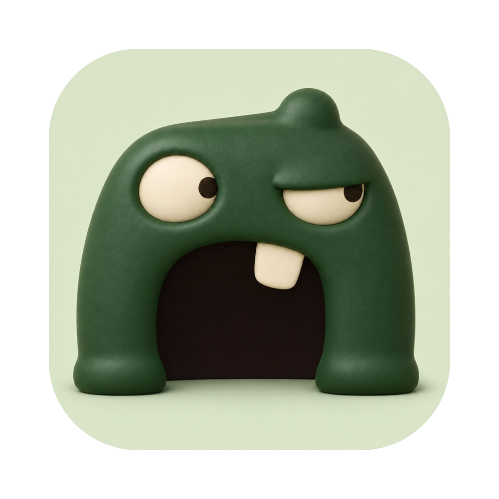
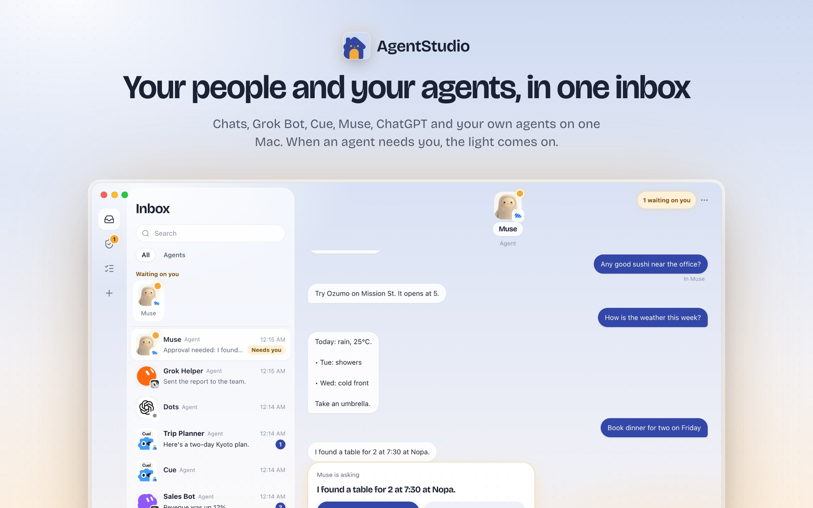
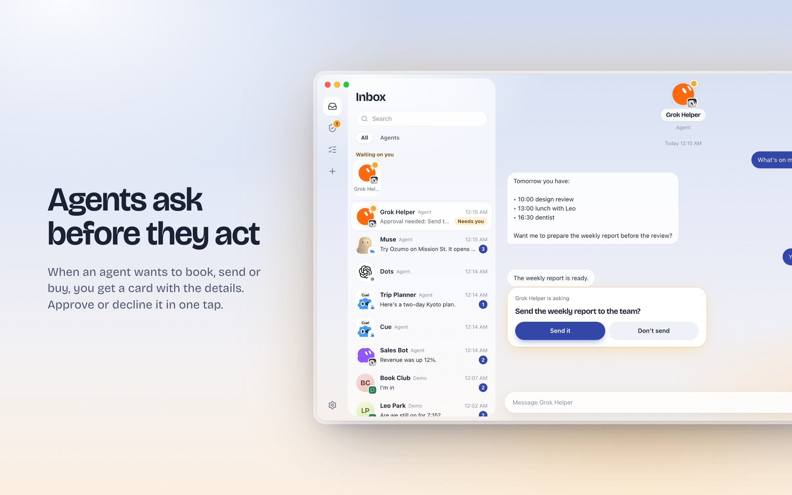
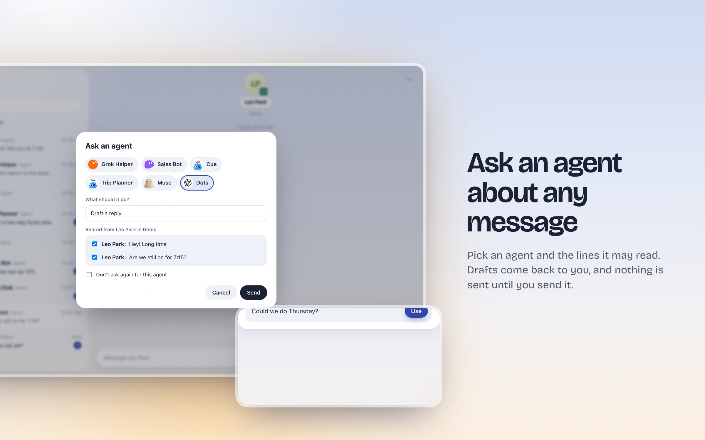
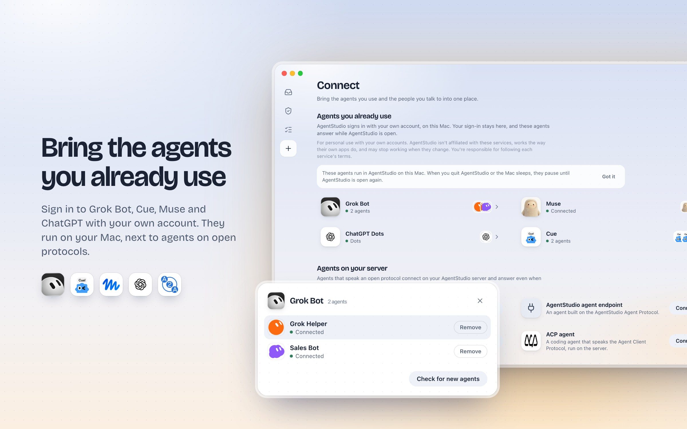

<p align="center"></p>

<h1 align="center">AgentStudio</h1>

**新增：以对话为主的个人工作间。** 从一句话开始，把进展、决定与可下载成果留在同一件事里。
运行 `pnpm build:personal && pnpm start:personal`，打开 `http://127.0.0.1:18740`。
安装、实际能力与边界见[运行说明](docs/personal/README.md)。

[English](README.md) · **简体中文**

<p align="center">
  
</p>

> [!WARNING]
> **仅供个人学习和研究使用。** AgentStudio 是一个个人工具：请在你自己的 Mac 上、用你自己的账号，连接你自己的 agent。**请勿用于商业用途**，也不要用来为他人提供服务。使用风险自负，使用前请先阅读[免责声明](#免责声明)。

> **Alpha 阶段。** 目前只支持 macOS，需要从源码运行，并在本机启动开发环境。可能会有不少粗糙的地方，也可能出现不兼容的改动。

一个开源的收件箱，用来统一管理你的聊天和 AI agent。agent 和你的联系人排在一起，像联系人一样出现。agent 需要你拍板时，会给你发一张审批卡片。你也可以把任意一段对话交给 agent，让它帮你起草回复。

当前状态：早期开发阶段（v0.1）。macOS 优先：先做桌面端（Electron），之后再做手机端（Expo）。目前没有任何托管服务，所有东西都运行在你自己的 Mac 上。

<p align="center">
  <a href="docs/media/agentstudio-demo.mp4">
    
  </a>
  <br>
  <sub>75 秒演示。<a href="docs/media/agentstudio-demo.mp4">观看 4K 高清版（MP4）</a>。</sub>
</p>

## 能做什么

- **一个收件箱**，装下聊天和 agent。人显示为圆形头像，agent 显示为圆角方形头像，右下角的小标记表示它来自哪个网络或服务。
- **审批。** agent 提出请求，你在聊天里或审批页点一下就能决定。
- **交给 agent。** 把一段聊天连同上下文交给 agent，它会返回几条回复草稿，可以修改后直接发送。
- **接入你已经在用的 agent**，用你自己的账号在 Mac 上登录：Grok Bot（账号下的每个 bot 都会接入，名字和头像各自保留）、Muse、ChatGPT Dots 和 Cue（用 Manus 账号登录，或者使用 Manus API key）。这部分是实验性功能，仅供个人使用，请看[下文](#免责声明)。
- **接入支持开放协议的 agent**：[AgentStudio Agent Protocol](docs/agent-protocol.md)、A2A 和 ACP。Hermes Agent 和 OpenClaw 会被自动识别，显示它们自己的图标。

<p align="center">
  
</p>
<p align="center">
  
</p>
<p align="center">
  
</p>

## 项目结构

| 部分 | 位置 | 说明 |
|---|---|---|
| 桌面端 | `apps/desktop` | Electron + React。Grok Bot、Muse、Dots、Cue 的连接器也运行在这里。 |
| 手机端 | `apps/mobile` | Expo / React Native。原生版本完成之前，先在网页版上测试。 |
| 客户端核心 | `packages/core` | Matrix 客户端、收件箱、审批、任务，两个端共用。 |
| 品牌素材 | `packages/brand` | AgentStudio 所连接服务的官方图片，附来源。 |
| 服务端 | `server`（Go） | `agentstudio-api`、`agentstudio-agents` 和 `demo` 两个桥接（mautrix bridgev2）、协议适配器、示例 agent。 |
| 消息服务器 | Synapse | 每个聊天底层都是 Matrix，联邦功能关闭。 |
| 开发环境 | `dev/stack.mjs` | 在本机用原生进程启动全部服务，不需要 Docker。 |
| 端到端测试 | `e2e` | 用 Playwright 测试 Electron 应用和手机网页版。 |

更多内容见 [docs/architecture.md](docs/architecture.md)。其他文档：[API](docs/api.md)、[客户端](docs/clients.md)、[设计](docs/design.md)、[Matrix 事件](docs/matrix-events.md)。（文档目前为英文。）

## 快速开始（macOS）

需要安装：Go 1.26+、Node 22+、pnpm、Homebrew 版 PostgreSQL 18、uv。

```bash
pnpm install
pnpm dev:up        # 启动 Postgres、Synapse、API、桥接和示例 agent（第一次约 30 秒）
pnpm dev:desktop   # 以开发模式启动 Electron 应用，连接本地服务
pnpm dev:mobile    # 在 Expo 网页版上运行手机端：http://localhost:18300
```

不需要注册账号：开发环境默认是本机模式，打开应用就直接进入收件箱。
（想试邮箱登录的话，退出登录后点"Sign in with email instead"。开发模式下验证码不会真的发邮件，可以在
`http://127.0.0.1:18090/v1/dev/outbox?email=<你的邮箱>` 查看，`.local/logs/api.log` 里也有。）
然后在 Connect 页添加 **Demo** 网络（模拟的联系人）和 **Concierge** agent，或者登录一个你已经在用的 agent。

管理本地服务：

```bash
pnpm dev:status          # 查看运行状态
pnpm dev:restart <name>  # 重启某个服务，例如 api、agents
pnpm dev:logs <name>     # 查看某个服务的日志
pnpm dev:down            # 停止全部服务
pnpm dev:reset           # 停止服务并删除 .local/ 下的全部本地数据
```

所有运行时数据（数据库、Synapse、日志）都在 `.local/` 目录下，这个目录不会提交到 git。

## 测试

```bash
pnpm test        # 单元测试：开发环境脚本、Go、TypeScript
pnpm test:e2e    # Playwright：Electron 应用和手机网页版，连接本地服务
```

如果 `pnpm install` 之后找不到 Electron 程序（pnpm 有时会跳过它的安装脚本），请在 `apps/desktop` 下运行
`node node_modules/electron/install.js`。Playwright 用的 Chromium 用
`pnpm --filter @agentstudio/e2e exec playwright install chromium` 安装。

## 接入 agent

| agent | 方式 |
|---|---|
| Concierge（内置示例 agent） | Connect → Agents on your server → Concierge |
| 任何实现了 AgentStudio Agent Protocol 的服务 | Connect → AgentStudio agent endpoint，填入它的地址和 token |
| A2A agent（例如 Hermes Agent） | Connect → A2A agent，填入 agent 的地址 |
| 服务端允许的 ACP agent（`AGENTSTUDIO_ACP_AGENTS`） | Connect → ACP agent |
| Grok Bot、Muse、ChatGPT Dots、Cue（仅 Mac 版，实验性） | Connect → Agents you already use。你的登录凭据（或 Cue 的 API key）只保存在这台 Mac 上；AgentStudio 开着时这些 agent 才会回复。 |

连接 Grok Bot、Muse、Dots 或 Cue 之前，请先阅读[关于第三方连接器的说明](#免责声明)。

调试连接器时，可以用 `AGENTSTUDIO_CONNECTOR_TRACE=1` 启动应用（再加上 `AGENTSTUDIO_CONNECTOR_SHOW=1` 可以显示 Muse / Dots 的后台窗口）。详见 [docs/connectors.md](docs/connectors.md)。

## 免责声明

**⚖️ 本项目仅供个人学习和研究使用。** 使用 AgentStudio 之前，尤其是使用 Grok Bot、Muse、ChatGPT Dots 和 Cue 的连接器之前，请先阅读以下内容。

- **仅限个人使用：** 请在你自己的 Mac 上、用你自己的账号连接你自己的 agent。请勿用于商业用途，不要用来为他人提供服务、批量自动化，或使用不属于你的账号。
- **只在本机运行：** 所有数据和登录凭据都留在你的 Mac 上，由系统钥匙串加密保存。AgentStudio 不会把任何内容上传到我们的服务器（我们也没有服务器）。
- **与相关服务无关联：** 本项目与 xAI / SpaceX AI、Cursor（Anysphere）、Meta、OpenAI、Manus、Nous Research、OpenClaw 均无关联，也未获得其认可。相关名称和图标归各自所有者，仅用于标明连接的是哪个服务。
- **非官方接入：** 除 Cue 的收发消息使用 Manus 公开的官方 API 外，其余连接器都模仿对方 App 或网页的工作方式，可能违反对方的服务条款，也可能随时失效。
- **责任自负：** 你需要自行遵守各服务的条款和所在地的法律法规。如不确定，请不要连接。
- **风险自担：** 本项目按"原样"提供，不提供任何担保（见 Apache-2.0 许可证）。作者不对使用本项目造成的任何损失、账号受限或其他后果负责。

各服务的具体情况见 [docs/connectors.md](docs/connectors.md)（英文）。

## 参与贡献和安全问题

- [CONTRIBUTING.md](CONTRIBUTING.md)：如何搭建环境、运行测试、提交改动。
- [SECURITY.md](SECURITY.md)：如何私下报告安全漏洞。请不要为安全漏洞开公开的 issue。
- [CODE_OF_CONDUCT.md](CODE_OF_CONDUCT.md)：行为准则。

## 许可证

Apache-2.0。第三方声明见 [NOTICES.md](NOTICES.md)；品牌图片归各自所有者（见 [packages/brand/README.md](packages/brand/README.md)）。
