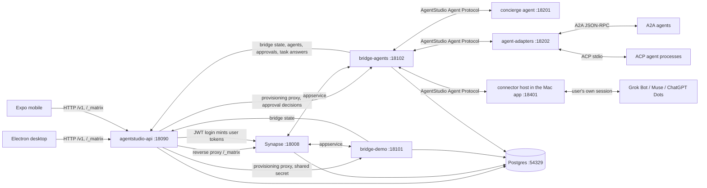

# AgentStudio architecture (v0.1)

> `apps/personal` adds a local, single-user conversation workspace with one Node/SQLite
> process, without Matrix. See [runtime and boundaries](personal/README.md) and
> [the design decision](personal/design.md). The architecture below describes the retained
> Matrix/Electron/Expo path. Account data is not automatically imported or migrated.

AgentStudio is an open-source inbox for your chats and your AI agents. Agents show up as contacts. When an agent needs a decision, it sends an approval card. You can forward any message, with its context, to an agent and get reply drafts back.

v0.1 runs locally on macOS. Desktop (Electron) comes first, then mobile (Expo / React Native).

## Scope of v0.1

| In | Out (later) |
|---|---|
| Email-code sign-in, sessions, Matrix credentials minted per user | Google/Apple sign-in, invites |
| Synapse homeserver, federation off | Hosted multi-region, sliding sync |
| `demo` network bridge (simulated contacts, deterministic) for development and e2e | Stock mautrix bridges in e2e (they need real accounts), and dev scripts to run them (planned under `dev/bridges/`). |
| `agentstudio-agents` bridge speaking the open AgentStudio Agent Protocol, plus A2A and ACP agents through `agentstudio-agent-adapters` | OpenClaw gateway adapter |
| Desktop connectors for Grok Bot, Muse and ChatGPT Dots through the user's own signed-in session, on the Mac (`docs/connectors.md`) | Connectors that keep running while the Mac app is closed |
| Reference agent `concierge` (deterministic, used by e2e) | Hosted agents |
| Approvals (REST, versioned, idempotent) with cards in chat | Push gateway, APNs |
| Tasks: "Ask an agent" with context preview, drafts back, insert into chat | Merged chats, mutes, pins |
| Electron Mac app: inbox, chat, connect accounts, agents, approvals, tasks, ask | iMessage helper (phase 2, Mac-local) |
| Expo mobile app: same core flows. Tested on web target until Xcode is installed. | Native iOS builds |
| Playwright e2e against a locally started stack | CI |

## Processes and ports (local dev)

All processes bind to 127.0.0.1. Runtime state lives under `.local/` (git-ignored).

| Process | Port | What |
|---|---|---|
| PostgreSQL 18 (Homebrew binary, private cluster in `.local/pg`) | 54329 | databases `synapse`, `agentstudio`, `bridge_demo`, `bridge_agents` |
| Synapse (uv venv in `.local/synapse-venv`) | 18008 | homeserver, `server_name: agentstudio.local` |
| `agentstudio-api` (Go) | 18090 | REST `/v1/*`, internal `/internal/v1/*`, and a reverse proxy for `/_matrix/*` to Synapse. Clients use this single base URL. |
| `agentstudio-bridge-demo` (Go, mautrix bridgev2) | 18101 | appservice and provisioning |
| `agentstudio-bridge-agents` (Go, mautrix bridgev2) | 18102 | appservice, provisioning, agent callback endpoint `/agentstudio/v0/callback/*`, and `/agentstudio/internal/v1/approval-decisions` |
| `agentstudio-agent-concierge` (Go) | 18201 | reference agent implementing the AgentStudio Agent Protocol |
| `agentstudio-agent-adapters` (Go) | 18202 | the AgentStudio Agent Protocol in front of A2A agents (`/a2a/{target}`) and allowed ACP agents (`/acp/{agent}`) |
| `agentstudio-dev-a2a-echo` (Go, dev only) | 18203 | a tiny deterministic A2A agent for e2e |
| desktop connector host (inside the Mac app) | 18401 | the AgentStudio Agent Protocol for the Mac's connectors (`/c/{instance}`), per-instance bearer token |
| `e2e/fakes/agents.ts` (tests only) | 18410 | fake Grok Bot backend and fake Muse / Dots pages |
| mobile web (Expo export, static; or `pnpm dev:mobile`'s Expo dev server) | 18300 | e2e target for the mobile app |
| desktop renderer dev server (`pnpm dev:desktop` only) | 5173 | electron-vite / Vite dev server for the Electron renderer |



## Repository layout

```
docs/                     architecture, API, agent protocol, Matrix events (the contracts)
server/                   Go module github.com/DolphinMiner/agentstudio/server
  cmd/agentstudio-api/
  cmd/agentstudio-bridge-demo/
  cmd/agentstudio-bridge-agents/
  cmd/agentstudio-agent-concierge/
  internal/api/...        REST handlers, auth, store, matrix minting, proxy
  internal/bridges/demo/  bridgev2 NetworkConnector
  internal/bridges/agents/
  internal/agentproto/    shared Go types for the AgentStudio Agent Protocol
  internal/agenthost/     agent side of the protocol (sessions, ordered callbacks) for adapters
  internal/adapters/      a2a/ and acp/ backends, served by cmd/agentstudio-agent-adapters
  internal/concierge/
packages/core/            TypeScript, no DOM or React Native imports: API client, session, Matrix client wrapper, event schemas, inbox model, ask builder
apps/desktop/             Electron + electron-vite + React renderer (bundled locally, never loads remote web code)
  src/main/connectors/    on-device connectors (Grok Bot, Muse, Dots) and their protocol host
apps/mobile/              Expo (React Native) app using @agentstudio/core
e2e/                      Playwright: desktop (Electron) and mobile (Expo web) specs; fakes/ for the connectors
dev/                      local stack: stack manager (stack.mjs), config templates
```

## Key decisions

- **License Apache-2.0.** Synapse and stock mautrix bridges are AGPL. They run unmodified as separate processes, so their license does not reach this repo. Our bridges depend only on mautrix-go, which is MPL-2.0 and applies file by file.
- **One base URL per server.** Clients only know `AGENTSTUDIO_SERVER_URL`. The API proxies `/_matrix`, so desktop, mobile and web share one origin per server.
- **Mixed state.** Message content lives in Matrix. Approval and task state lives in REST, with `version` for optimistic concurrency and `idempotency_key` for retries. Cards in chat only reference REST ids.
- **No E2EE in v0.1.** Bridges must read plaintext. This matches the bridge model; see `docs/api.md` § Security.
- **Open protocols first, the user's own session where there is none.** Agents that speak the AgentStudio Agent Protocol, A2A or ACP connect on the server (`docs/agent-protocol.md`). Grok Bot, Muse and ChatGPT Dots have no public API, so the Mac app connects them through the user's own signed-in session (`docs/connectors.md`): their sign-ins stay on the Mac, encrypted, and the services can change or object at any time.
- **Determinism for tests.** The `demo` bridge and the `concierge` agent behave deterministically, so e2e runs without real accounts.
