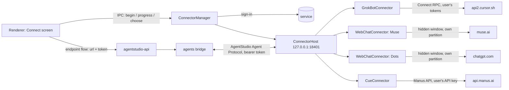

# Connectors on the Mac: Grok Bot, Muse, ChatGPT Dots, Cue

These are the retained **Matrix-mode** connectors, selected by `AGENTSTUDIO_WORKSPACE=matrix`. Default personal startup does not initialize them or read their saved sessions. The personal workspace instead uses explicitly configured A2A/MCP endpoints and an optional separate Bearer file vault; see [the personal guide](personal/README.md). Its public identity metadata is not a verified remote account.

Hullo connects these agents through each user's own web session, and so does AgentStudio. None of them offers an API for third-party inboxes. AgentStudio differs in one way: the connectors run inside the Mac app, so the user's sign-ins never leave the Mac.

> **Experimental, and for personal use only.** These connectors are for reaching your own agents with your own accounts on your own Mac. AgentStudio isn't affiliated with or endorsed by xAI / SpaceX AI, Cursor (Anysphere), Meta, OpenAI or Manus. Except for Cue's messaging (Manus's documented API), they work the way each service's own app or website does, which may be against a service's terms and can break at any time; you are responsible for following each service's terms. Each connector was built from the service's public client code and checked against fakes (`e2e/fakes/agents.ts`); expect to calibrate it on first real use (see *Calibrating* below).

## How it fits



- **Instances.** Each connected account is an *instance*: `{id, service, token, name, data}`. Instances are stored encrypted with `safeStorage` in `userData/connectors.bin`, so the token and the service's tokens never sit on disk in plain text.
- **Host.** It listens on loopback only. Each request needs the instance's bearer token, and callbacks to the bridge are queued per instance so they stay in order.
- **Web sessions.** Muse and Dots each run in their own persistent Electron partition (`persist:agentstudio-muse`, `persist:agentstudio-dots`), so their cookies are separate from the app and from each other. Their APIs can't be called directly (see `docs/spikes/muse-dots-direct-api.md`), so the service's page does the talking.
  - **The page window never shows.** "View in Muse" / "View in ChatGPT" (Connect sheet), and cards AgentStudio can't show, open the service in the user's browser instead. `AGENTSTUDIO_CONNECTOR_SHOW=1` still shows it, for calibrating.
  - **Reconnecting.** The connector reloads the page when it shows a connection problem ("Connection error", "Reconnecting", "Offline", …) for 15 s, crashes, stops responding, fails to load, or can't be read 5 times in a row. Reloads back off (15 s, 30 s, 60 s, 2 min, then every 5 min). Meanwhile the agent shows "Reconnecting…" in the inbox and the Connect sheet, a message sent waits up to 45 s, and no "agent problem" notification goes out. Replies that arrived during the outage are still relayed.
  - **Sign-in happens in an AgentStudio window**, not the browser: these sites keep the sign-in in the browser's cookies, which other apps can't read.
  - The page runs in a hidden window. Page scripts run in an isolated world.
  - The user agent is plain Chrome, without the Electron token.
  - Sign-in happens in a visible window on the same partition.
- **Offline behaviour.** When the Mac app is closed, these agents don't answer. When it starts again, the connectors resume.

## Grok Bot

Grok Bot (SpaceX AI, built by Cursor) has no web UI. Its desktop app, 0.78.3 (`com.anysphere.sand`), talks Connect RPC (protobuf) to Cursor's backend. The connector does the same with the user's account.

| Step | What |
|---|---|
| Sign-in | Opens `https://cursor.com/loginDeepControl?challenge=<S256(verifier)>&uuid=<uuid>&mode=login&redirectTarget=sand` in the browser. Then it polls `GET https://api2.cursor.sh/auth/poll?uuid&verifier`: 404 means pending, 200 returns `{accessToken, refreshToken}`. |
| Refresh | `POST /oauth/token {client_id: "KbZUR41cY7W6zRSdpSUJ7I7mLYBKOCmB", grant_type: "refresh_token", refresh_token}` |
| Headers | `x-cursor-client-type: sand`, `x-cursor-client-version: 0.78.3`, `x-cursor-client-os: darwin`, `x-sand-box-namespace: prod`, `x-ghost-mode: true`, `x-cursor-checksum: <obfuscated time><machine id>` |
| RPCs | `aiserver.v1.GrokBotService/` `ListGrokBotAgents`, `SendGrokBotUserMessage {agent_id, message_id, text, sent_at_ms, session_id}`, `ListGrokBotTranscriptEntries {agent_id, limit, session_id}`, `RespondGrokBotWidget {agent_id, entry_id, value, session_id}`, `DismissGrokBotWidget` |

- **Bots.** One sign-in connects every bot of the account; each becomes its own contact. Bots that are already connected are skipped. All bots of an account share one client, so a token refresh, which rotates the refresh token, happens once. `session_id` is the bot's `viewer_session_id`.
- **Replies.** The transcript is polled every 2 s after a message and every 15 s when idle. Only entries newer than the connection are relayed.
- **Entry bodies.** These are read as JSON: `{kind: "message", role, content}`, `{kind: "send-message", message: {content}}`, and `widget*` entries with `options`.
- **Widgets.** Grok Bot's cards arrive as `send-message` entries with `message: {type: "widget", widget: {prompt, options: [{label, value}]}}`. A widget becomes an approval card whose choices are the widget's options; a widget without options shows as its question. A "Dismiss" choice is added when none of the options reads as a no.

## Muse

This connector drives Meta's Muse at `muse.ai`. The page driver (`apps/desktop/src/main/connectors/drivers.ts`) uses the markup that beeper-muse (MIT) validated against live Muse:

| Part | Selector |
|---|---|
| Composer | `textarea[aria-label="Message"]` |
| Send button | `button[aria-label="Send"]` |
| Message log | `[role="log"][aria-label="Chat messages"]` |
| Messages | `[data-message-item][data-message-id][data-message-role]` |
| Busy state | `aria-busy` |

- **Replies** are relayed once their text stops changing and Muse is idle.
- **Approvals.** Buttons in a reply that read as yes/no (Approve/Deny, Book/Don't book, …) become an approval card. Answering the card clicks the button on the page.
- **Other interactive cards** become a card with **Open Muse**, which shows the Muse window so the user can answer there.

## Cue

Cue (cue.im, by Manus) gives each personal agent its own email, phone number, wallet and computer. It has no web app, but Manus publishes an API that covers Cue's agents ([Agents](https://open.manus.ai/docs/v2/agents-overview)), so this connector is built on a documented API. Only the web sign-in's key creation uses an internal call; if Manus changes it, pasting a key still works.

| Step | What |
|---|---|
| Sign-in (default) | Like the Cue desktop app, in the user's browser (Google and Apple refuse sign-in in embedded windows): AgentStudio opens `manus.im/login?from=desktop&type=signIn&desktopAgents=1&nonce=…&redirectUrl=manus.im/login-success?…agentsScheme=cuedev…`. The page hands the session back on `cuedev://oauth/desktop-callback?nonce=…&token=…`. Manus only allows `cue://` (the Cue app's) and `cuedev://` (Cue's dev builds), so AgentStudio takes `cuedev://` with a tiny helper app it builds once in `userData/link-catcher` (AppleScript via `osacompile`, bundle id `org.agentstudio.link-catcher`). The helper writes each link to a file AgentStudio reads. AgentStudio can't claim the scheme itself: unpackaged Electron shares one bundle id between every copy on the Mac, so macOS could hand the link to another checkout. The Cue app doesn't need to be installed. With the session, AgentStudio calls Manus's internal `POST api.manus.im/openapi.v1.OpenapiService/CreateAPIKey {name: "AgentStudio (date)"}` once, and keeps only the API key. The user can delete that key in Manus settings to revoke AgentStudio. |
| Sign-in (API key) | "Use an API key instead": the user creates a key in Manus settings (Developers → Create API Key) and pastes it. Also offered when web sign-in fails. |
| Checking the key | `GET /v2/user.me`. The key is stored encrypted with the other connector secrets. |
| Agents | `GET /v2/agent.list` (agents created in Cue) plus `GET /v2/agent.detail?agent_id=agent-default` (the account's default IM agent, named "Cue"). Each becomes its own contact. Each agent has a **main task**, its conversation. |
| Reading | `GET /v2/task.listMessages?task_id=…&order=desc&limit=30`, every 3 s after a message and every 20 s when idle. All agents of one key share a budget of 80 requests a minute, under Manus's limit of 100. |
| Writing | `POST /v2/task.sendMessage {task_id, message: {content}}` |
| Questions | An `assistant_message` with `question_expectation.options` becomes an approval card with one choice per option, plus "Answer in Cue". The chosen option is sent back as a message. |
| Confirmations | A `status_update` with `agent_status: waiting` and a `waiting_for_event_id` (other than `messageAskUser` / `cascadeAskUser`) becomes an approval. Answered with `POST /v2/task.confirmAction`: `{accept: true/false}` when the schema has a boolean `accept`, otherwise one choice per `action` or `choice` value. Schemas AgentStudio can't fill (for example selecting ad accounts) show as a message asking the user to answer in Cue. |
| Status | `running` shows the agent as working (with its `brief`); `stopped`, `waiting` and `error` set it idle. `error_message` events show as a message. |
| Files | Attachments of an answer are added as links. |

- **Avatars.** The Manus API doesn't expose agents' avatars, so Cue agents show the Cue icon for now.
- **Answered elsewhere.** A message sent from the Cue app cancels AgentStudio's open cards for that agent.

## ChatGPT Dots

This connector drives `chatgpt.com/dots` (the "orbit" routes) in the same way. The driver understands two kinds of ChatGPT markup:

| Markup | Messages | Composer | Submit / busy |
|---|---|---|---|
| Classic | `[data-message-author-role]`, `[data-message-id]` | `#prompt-textarea` (contenteditable) | `[data-testid="send-button"]`, `[data-testid="stop-button"]` |
| New "octane" | turns marked by `[data-user-message-actions]` / `[data-assistant-message-actions]` | `textarea[name="prompt"]` | `button[data-composer-submit]` |

The authenticated Dots pages could not be inspected without an account. This is the connector most likely to need calibration.

## What comes over from each service

On first connect each connector imports the last 20 messages of the conversation as history (no notifications). After that:

| Service | Shown | Shown as a note ("Open … to see it") | Left out |
|---|---|---|---|
| Grok Bot | `message` (assistant), `send-message` `text`, `send-message` `widget` (a card), what the user typed in Grok Bot (`message` role user, `user-attachment`) | `send-message` `attachment` and `visualization`, `voice-call`, `mcp-app`, any kind AgentStudio doesn't know | `tool-call`, `notice`, `event`, `feedback` (Grok Bot's internals) |
| Cue | `assistant_message` (text and files; files come over as images/files), questions with options (a card), action confirmations (a card), `error_message`, what the user typed in the Cue app (`user_message`) | confirmations whose input AgentStudio can't fill | `status_update` (shown as working/idle), `tool_used`, `plan_update`, `explanation` |
| Muse, Dots | replies, yes/no buttons (a card), what the user typed on the page | interactive cards without yes/no buttons | message menus |

AgentStudio's own messages appear in each service's transcript too; connectors skip them (by text), so they show once.

## Avatars

Each connector gives its agent a real picture. The host serves it at `GET /c/{instance}/agentstudio/v0/avatar`. This route needs no token (instance ids are random and the host listens on loopback only). `info` and `profile` events point the bridge there, with a version query that changes with the image. The bridge stores the picture as the agent's Matrix avatar, so every client shows it.

| Service | Picture |
|---|---|
| Grok Bot | The bot's photo (`avatar_url`) if it has one. Otherwise the avatar Grok Bot draws from the bot's `avatar_shape` and `avatar_color` (a bot with neither gets Grok Bot's own default for its id). AgentStudio doesn't ship Grok Bot's shapes: when the Grok Bot app is installed, it runs that app's shape code once in a hidden, offline, sandboxed window, keeps one mask per shape in `userData/grokbot-shapes` (redone when the app's version changes), and tints the bot's mask with its color. Without the app, or if its code changed, the bot shows the Grok Bot icon. Changes are picked up when the connector starts. |
| Muse | The persona's avatar from the page: ``, or a frame of its avatar video. Otherwise the Muse mascot. |
| ChatGPT Dots | The Dot's avatar from the page (an image labelled with the page heading); otherwise the ChatGPT logo |
| Cue | The Cue app icon (the Manus API has no agent avatars yet) |

The fallback images are the official ones in `packages/brand`.

## When something goes wrong

- **In the inbox:** an agent whose service signed it out (or that can't be reached) shows "Sign in again" / "Not connected" on its row, and a bar above the list says how many need attention, with a button to the Connect screen.
- **Diagnostics:** Settings → Diagnostics → Export writes a JSON report: app and OS versions, each connector's state, and the last connector traces. Anything that looks like a credential (bearer tokens, API keys, signed URL parameters, JWTs, cookies) is removed before writing.
- **Stored connectors are never dropped** because one failed to start or the app quit while starting: records that aren't running are kept as stored.

## Calibrating against the live services

1. Start the app with tracing:

   ```bash
   AGENTSTUDIO_CONNECTOR_TRACE=1 AGENTSTUDIO_CONNECTOR_SHOW=1 pnpm dev:desktop
   ```

   - `AGENTSTUDIO_CONNECTOR_SHOW=1` shows the hidden Muse/Dots windows.
   - `AGENTSTUDIO_CONNECTOR_TRACE=1` writes `userData/connector-traces/<date>.jsonl`. It contains RPC status codes, entry kinds and reply sizes, but no message text.
   - Add `AGENTSTUDIO_CONNECTOR_TRACE_BODIES=1` to record Grok Bot entry bodies too. They contain the conversation, stay on the Mac, and should be deleted after use.
2. Connect the service, send a message, and wait for an approval request.
3. If a reply doesn't arrive, compare the trace (Grok Bot) or the page in the shown window (Muse, Dots) with `parseEntry()` and the selectors in `drivers.ts`. Adjust them and add the shape to the unit tests in `apps/desktop/test/connectors.node.test.ts`.

## Environment

| Variable | Default | Use |
|---|---|---|
| `AGENTSTUDIO_CONNECTOR_PORT` | 18401 | Connector host port. `0` picks a free port; tests use this. |
| `AGENTSTUDIO_GROKBOT_API_URL` / `AGENTSTUDIO_GROKBOT_WEB_URL` | `https://api2.cursor.sh` / `https://cursor.com` | Grok Bot endpoints |
| `AGENTSTUDIO_GROKBOT_APP` | `/Applications/Grok Bot.app`, then `~/Applications` | The Grok Bot app whose shapes draw bot avatars; empty for none (tests) |
| `AGENTSTUDIO_GROKBOT_POLL_MS` | 2000 | Transcript polling interval while active |
| `AGENTSTUDIO_CUE_API_URL` / `AGENTSTUDIO_CUE_POLL_MS` | `https://api.manus.ai` / 3000 | Manus API, and Cue polling while active |
| `AGENTSTUDIO_CUE_WEB_URL` / `AGENTSTUDIO_CUE_RPC_URL` | `https://manus.im` / `https://api.manus.im` | Manus sign-in pages, and the API used to create the key |
| `AGENTSTUDIO_MUSE_URL` / `AGENTSTUDIO_DOTS_URL` | `https://muse.ai/` / `https://chatgpt.com/dots/home` | Pages the web connectors open |
| `AGENTSTUDIO_CONNECTOR_OPEN_IN_WINDOW` | off | Open the Grok Bot sign-in page in an AgentStudio window instead of the browser (tests) |
| `AGENTSTUDIO_CONNECTOR_SHOW` | off | Show the hidden service windows |
| `AGENTSTUDIO_WEBCHAT_GRACE_MS` | 15000 | How long a Muse / Dots page may show a connection problem before it is reloaded |
| `AGENTSTUDIO_CONNECTOR_TRACE`, `AGENTSTUDIO_CONNECTOR_TRACE_BODIES` | off | See *Calibrating* |
| `AGENTSTUDIO_CONNECTOR_TRACE_NETWORK` | off | Record the shape of the API calls the Muse / Dots pages make (`userData/connector-traces/network-<date>.jsonl`): method, URL, header names, JSON keys and types, scripts loaded. No message text, tokens or cookies. See `docs/spikes/muse-dots-direct-api.md`. |
