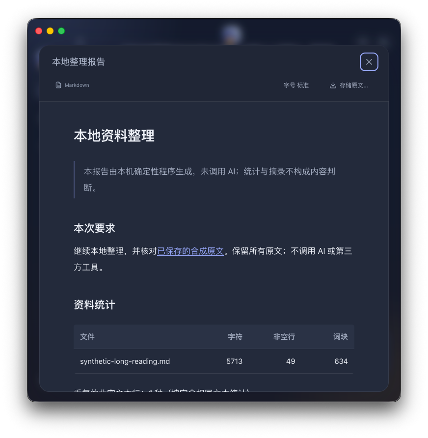

# macOS 原生交付验收

GET-476 · 2026-11-10。用户明确要求沿用目标仓库的 macOS 风格并实际在本机启动、连接。上一轮辅助 Web 的证据不能证明桌面体验；本记录单独核对原生应用。

## 实际入口与版本

默认入口为 `apps/desktop`：`pnpm dev:desktop`；独立安装包由 `pnpm package:mac` 构建。`AGENTSTUDIO_WORKSPACE=matrix` 保留原 Matrix 路线。个人模式不读取旧会话或启动原连接器，不附着另一个运行中的 Web 服务。

验收环境为 macOS 26.4 / Apple Silicon；实际 Electron 45.2.1、内置 Node 24.22.1、SQLite 3.53.4。功能验收使用基于 `7d85801babbc56f9eb5cb6d180d922ede8108bd6` 的本 PR 工作树；health 如实带 `-dirty`。原生 UI entry SHA-256 为 `76d9433691ff6e6570f2cba6f6e8282cdf5fc9b3c2287692326bc67ab20bb452`，四个后端文件保持原实现。后续合并版本必须重新构建并读回 build ref，不能将工作树结果冒充合并版验收。

## 完整用户过程

1. 打开 Mac 应用，直接看到输入框。原生 traffic lights、可拖拽区域、72px rail、浅玻璃列表和蓝暮色背景沿用仓库 `docs/design.md` 的 porch light 设计；没有 Matrix 登录前置。
2. 从界面上传两份合成阅读方案，用自然语言要求比较。系统使用现有 Codex CLI 配置，不切换提供方或导出凭据。关闭窗口后任务仍完成。
3. 再打开同一窗口，阅读中文比较表。引用可打开已保存原文，Esc 只关闭最上层来源。保存 Markdown 后读回 SHA-256 与成果记录相同。
4. 在连接界面添加公开 DeepWiki MCP，无私人 token。要求读取 `facebook/react` 公开文档目录；实际调用在精确决定前保持待处理、没有成果。确认后调用真实 MCP，保留目录、工具回执和成果哈希。
5. 退出并重新打开应用，两件已完成的事及成果仍在。由独立 `.app` 再次打开同一隔离验收 profile，仍可读取和导出两份结果；包内 utility 自行启动，退出时停止。

上述真实过程由 `dev/personal-desktop-real.mjs --real` 记录为 13 项断言。CLI 产物 1477 bytes，SHA-256 `60b3c294719becd05d54f90fb61112863b1db2ba261fa69b8e6d745e34452d5a`；MCP 产物 1627 bytes，SHA-256 `c835c58c7aade99f0984f2789e854cf716460a3acb2a199dd8363aaf81e67cc5`。这些是合成附件与公开文档，不能代表私人第三方账号验收。

## 实际界面

前两张来自 packaged app 的系统窗口捕获；第三张仅 renderer，不混称为系统截图。完整本地证据还包含宽表、长代码、来源叠层、200% 缩放和侧栏。参考与取舍见 [Mac 决策记录](macos-decision.md) 及既有[视觉研究](research/visual-research.md)。

## 验证范围

| 证据 | 实际结果 | 范围 |
| --- | --- | --- |
| Desktop unit | 62/62 通过，含新增 19 项原生契约与 host 测试 | 信任边界、保存校验、生命周期与并发；不等于实际窗口验收 |
| Personal backend | 40/40 通过 | 隔离 SQLite、假 CLI 和合成远端服务 |
| Dev manager | 4/4 通过 | 保留原本机栈管理行为 |
| 辅助 Web | 24+15 项通过，无页面异常 | 修正异步等待后重跑；不作为原生缩放证据 |
| 实际 CLI / 公开 MCP | 13 项通过 | 使用本机已有配置和真实公开服务，仅合成或公开数据 |
| 独立包读回 | 6 项通过 | 最小 Finder 风格 PATH 能发现 Codex、包内 file renderer、真实历史与导出哈希、一个自有 utility、退出停止 |
| Packaged native smoke | 60 项断言通过，0 页面异常，11 张系统窗口截图、0 fallback | 含截图检查；全程强制缺失 CLI、只做确定性本地整理，不冒充 AI |
| 长内容 | UI 上传 18 节中文 Markdown，原文与导出字节匹配，阅读位置恢复 | 结构化宽表和代码可用键盘局部滚动，双 Esc 与焦点返回通过 |
| 尺寸与主题 | 深色、760px、Electron `webContents` 真正 200% 缩放通过 | 可达侧栏、读者关闭按钮和页面无横向溢出；不等于 VoiceOver 或物理键盘验收 |

本机完整原始证据保存在注册测试目录 `ai-test-get-476-macos-desktop.YgcIHJ`：`real-r2/real-results.json`、`packaged-readback.json`、`packaged-smoke/smoke-yJpdKb/native-smoke.json` 和 `web-regression/`。复现可设置 `AGENTSTUDIO_DESKTOP_EVIDENCE_DIR`，脚本为每次运行创建独立 profile。

## 发现后修正的事项

- 测试最初把异步 API 谓词交给 `page.waitForFunction`，提前返回后退出应用；任务正确进入“结果未知”，没有成果。改用 Node 端 `expect.poll` 真正等待异步结果后重跑真实过程；浏览器脚本同样修正并重跑。失败与成功证据分开保留。
- 只读独立审查复现了并发 restart 与后续 stop 的竞争。修复后，关闭优先于旧重启意图；并发重启合并为一次，进程标识与创建时间相符才允许兜底终止。独立 6 项生命周期探针和原生 19 项测试通过。
- 原生 200% 缩放暴露列表可达性要求：900px 以下改为抽屉，200% 的 600px CSS 视口仍有显式按钮和焦点入口。实际窗口验证，不用等效 viewport 冒充缩放。
- Finder 风格最小 PATH 缺少用户 CLI 目录：仅给自有 utility 补普通安装路径，原 PATH 优先，不读取 shell 启动脚本、不变更账号或提供方。独立包最小 PATH 读回已验证。
- 首次安装包虽通过 `codesign --verify`，启动仍被 dyld 拒绝：ad-hoc 无 Team ID，与默认 Hardened Runtime 库校验冲突。按本机 `@electron/osx-sign` 2.7.2 的 `optionsForFile` 接口修正，仅用 allow-jit entitlement、本地 ad-hoc、关闭 Hardened Runtime。脚本现在读取实际签名标志及 entitlement，错误立即失败；修复后的包已实际启动通过。依据：[官方 osx-sign 接口](https://github.com/electron/osx-sign/blob/main/src/types.ts)、[官方 ad-hoc 说明](https://www.electron.build/v26/docs/mac/)。

## 尚未证明

这是本机单人 Alpha。包使用本地 ad-hoc 签名，不是 Developer ID、公证、商店或公网发布。凭据仍为 AES-GCM 文件 vault，不是 Keychain。CLI 按自身工具与 sandbox 权限执行，提示词不构成强制数据范围隔离。

原 Matrix 全栈、私人账号/OAuth、物理键盘加速键、VoiceOver、真实中文输入法、系统睡眠/唤醒未在本轮实际验收。菜单测试调用真实 `MenuItem.click` 并核对注册 accelerator，不冒充物理快捷键。保存测试使用显式测试导出目录，验证真实文件写入与哈希，没有声称操作了系统 Save As 面板。下一项最值得改进的是私人账号的身份确认、授权失效与恢复，并将文件 vault 迁到适合原生应用的系统凭据存储。
