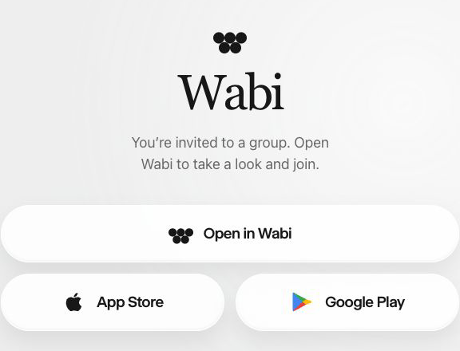
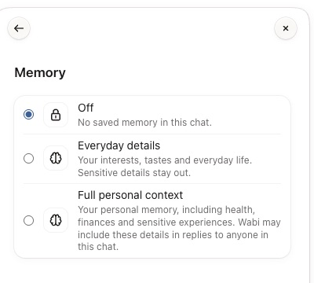
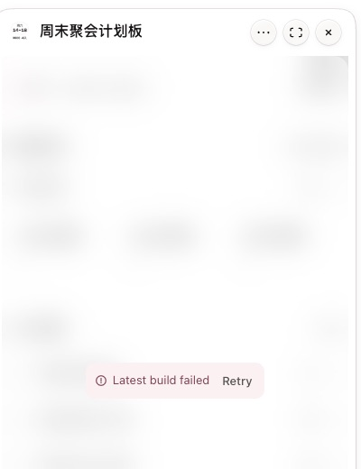
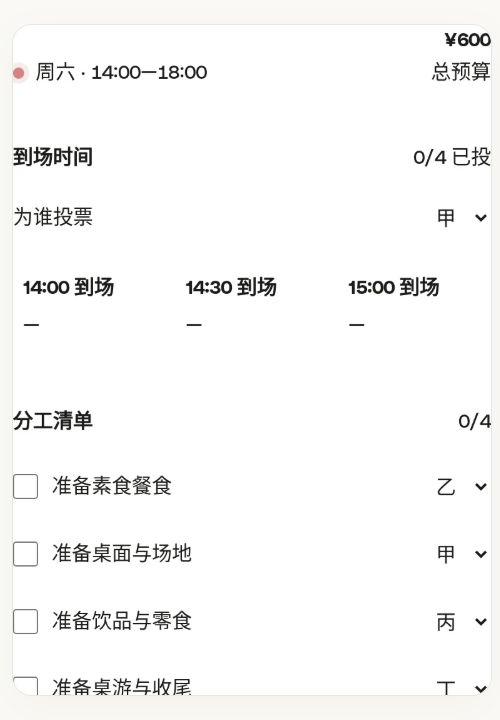
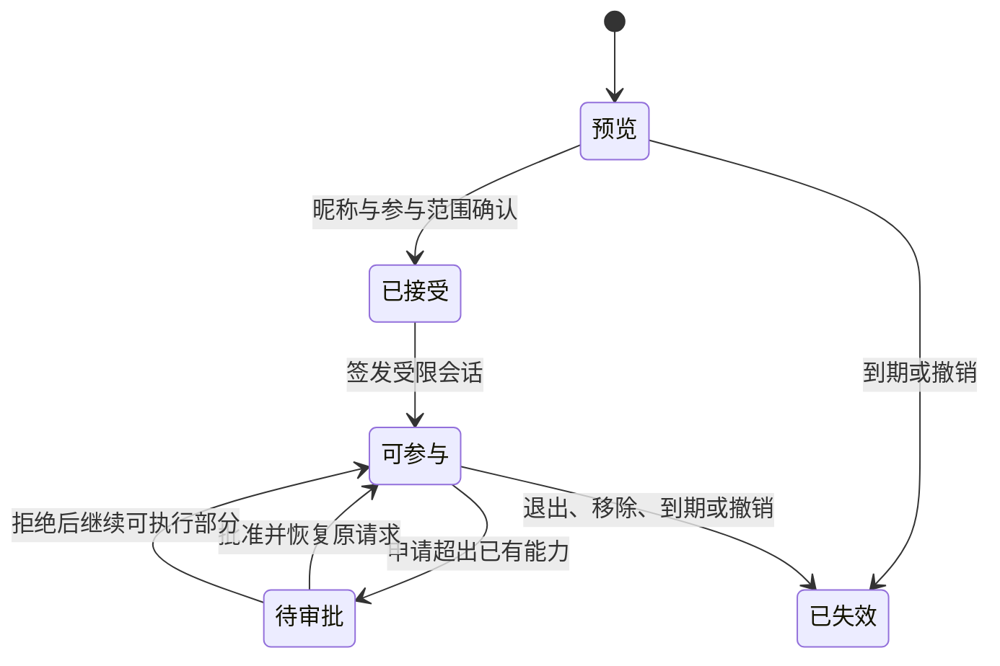

# Wabi 实测：邀请、群上下文与轻量分享

研究日期：2026-11-12。对象：官方 macOS 客户端 0.1.31、匿名网页，以及随安装包交付的静态客户端。本文记录研究和设计建议，没有新增 AgentRoom 功能。

**建议先验证一件事：把一个已有背景、能完成具体任务的 Agent，作为链接分享给朋友。朋友打开网页，填昵称，确认参与范围，就能提问或完成一次操作。** 旅行投票、聚会分工、帮父母查一份资料，分别是这个定义的不同入口。

Wabi 已经把话题、多人、个人资料授权和生成成果接了起来。此次实际走过的匿名邀请页仍主要引导打开或安装客户端；生成应用的外链能看静态预览，未提供匿名交互。AgentRoom 可以沿用它的话题结构，把第一次有效参与放到网页里。

## 1. 证据口径

| 标记 | 含义 | 可支持的结论 |
|---|---|---|
| UI | 本轮实际操作、界面读回、截图 | 在这个版本和环境出现的行为 |
| 接收端确认 | 同一用户在本人另一账号确认 | 需要接受邀请；接受后可见此前的消息 |
| 静态结构 | 只读安装包中的客户端路由、数据模型和文案 | 客户端区分了哪些对象及状态，不证明服务端强制执行 |
| 建议 | 针对 AgentRoom 的独立设计 | 尚未实施或验收 |

使用两个都属于用户本人的账号，没有向第三人发邀请。交互测试只使用专用合成话题；没有给测试群开放邮箱、位置、个人记忆或既有 Vault 资料。没有从客户端提取认证凭据，也没有直接调用未公开的服务接口。原始证据保存在用户本机；本文不携带账号标识、邀请能力、联系人、真实消息或第三方客户端源码。

用户提供的《84 个用例》作为研究材料使用，其中中文场景解释没有当作已实现功能。本轮 Explore 界面也读到了 84 张卡片。场景存在、功能实现、真实用户需求，分别需要不同证据。

官方当前首页强调多人一起使用、群聊中的执行、按任务提供界面，以及手机和电脑衔接。这是产品承诺，下面的实测单独判断。[Wabi 官网](https://wabi.ai/)

## 2. 走过的流程

### 2.1 从一句话生成一个话题

1. 新建入口包含场景卡片和一个输入框，无须先选模型、配置 Agent 或画工作流。
2. 在专用父话题中明确要求建立“研究测试｜周末聚会”。Agent 创建了另一个命名话题，在新话题放入简短背景，并在父话题留下可进入的卡片。
3. 后续打开 Explore 的朋友聚会场景，一次点击就建立了同名话题。Agent 自动提出朋友、活动、区域、预算、饮食限制等问题，用户没有先提交表单。

第二步是对明确创建请求的响应，不能推导成“所有新聊天都会再创建子话题”。也未验证父子话题持续双向同步。

值得采用的是：先接住用户要做的事，名称、开场问题和必要上下文由 Agent 补齐。场景卡片应启动一件事，产品不需要为每个场景发明一种数据结构。

### 2.2 邀请已有账号进入原话题

1. 进入话题详情，选择邀请，按用户名搜索本人另一账号。
2. 勾选后发送邀请。主人端保留原话题 ID，显示两位成员和加入提示。
3. **接收方仍有接受邀请的环节。** 用户对聚会话题和后来的朋友聚会测试均确认了这一点。
4. 用户确认，接受第一份邀请后能看到加入前的背景消息。

主人端的加入提示和人数只证明该端当前的显示，不能单独证明接收者已经接受。此次没有捕获接收方接受前的完整页面，因此不判断它是否已经预览旧消息，也不判断加入提示与接受动作的准确先后关系。

设计上可以明确区分“邀请已发出、待接受、已加入、已离开”。接收方的接受，确认的是愿意参与这个话题；它不自动代表分享自己的邮箱、记忆，或批准任何外部操作。

### 2.3 群链接与个人邀请是两条入口

| 分享对象 | 主人端入口 | 匿名网页实际结果 |
|---|---|---|
| 本人 / 产品邀请 | 全局邀请、个人二维码、复制链接 | 个人头像与身份、下载入口；本次点击下载经深链接到了 App Store |
| 具体群 | 群详情的邀请面板；未选人时出现复制链接和系统分享 | 通用群邀请页，打开客户端、两个应用商店、手机二维码 |
| 生成的聚会应用 | 应用菜单或 Widgets 中复制链接 | 标题、作者、静态预览图片与下载入口 |

群链接确实存在，不能因为全局按钮复制的是个人主页就认定没有群邀请。实测群落地页没有显示群名、邀请者、任务背景，也没有网页聊天输入框。测试限于本轮匿名浏览器环境；没有据此断言所有系统、版本、深链接都相同。

个人邀请页另检查了 390×844 布局。两个普通视口抓取出现采集缩放问题，已排除；完整页面截图与页面尺寸匹配。它们不计为 Wabi 的产品问题。

### 2.4 多人话题有独立的个人资料授权

群详情出现连接、成员等入口。聚会群初始选择为 Private；个人记忆关闭，位置关闭，已有邮箱连接关闭，Vault 未选择条目。

授权页的问题面向当前用户：这个话题可以使用你的哪些连接。记忆分为关闭、日常偏好、完整个人上下文；完整档位明确说明，健康、财务和敏感经历可能出现在给群内任何人的回复中。

这解决了一个很实际的关系问题：同一个人可以在家庭群提供日常偏好，在旅行群提供行程资料，在临时活动里只用本群消息。加入群、调用 Agent、提供个人资料，有各自的授权范围。

**旧消息仍然是独立问题。** 关闭连接不会让已经写进聊天的内容消失。把一段私人 AI 聊天改成群聊时，需要提前说明共享历史，或先生成一份可审核的背景摘要，再开启共享话题。不能把连接关闭理解为历史已经清理。

### 2.5 应用卡片、静态外链与真正可用分别验收

给聚会群提出明确的合成请求：四名虚构成员、周六下午、总预算 600 元、一位素食者，生成时间投票、分工、每人预算和确认状态。

约两分钟后收到应用卡片。点击后出现构建失败，点重试后再次出现相同失败状态。另一次重新打开也未得到可操作界面。本轮没有验证投票、保存、多端同步或多人同时编辑。

应用菜单提供话题内固定、首页固定、复制链接、桌面展示等入口。Widgets 列表能找到这张聚会卡片，并标出来源话题。

复制的成果外链可匿名打开，显示了一张带投票、清单外观的预览图。页面 DOM 中只有这张图片和导航 / 下载入口，没有对应表单控件或应用 iframe。**看得到控件的图片，不代表访客可以操作这些控件。**

失败根因未知。同一阶段也遇到 Linear 连接失败和一次 Git HTTPS 失败，不能把上述状态归因于 Wabi 生成代码本身。后续 Git 重试恢复。这里记录体验断点，不给未经排查的根因结论。

### 2.6 上下文隔离做了一次合成检查

在专用父话题放入一个合成校验码，要求只留在该聊天、不写个人记忆。随后在聚会群问该校验码，限定只能依据本群消息，不搜索其他聊天或连接。Wabi 回答本群未知。

这次检查符合预期，但提示词本身也要求了隔离，因此它只支持“一次回答未自动带入父话题内容”。没有验证攻击条件、工具访问控制、服务器过滤、长期记忆误写或所有跨房间路径。

### 2.7 其他实际查看过的能力

| 表面 | 观察 | 本轮边界 |
|---|---|---|
| Explore | 84 个生活 / 工作场景；朋友聚会一次点击生成话题和开场 | 卡片不等于场景已验证有效 |
| Widgets | 成果集合、来源话题、独立分享入口 | 未证明生成应用状态能协作同步 |
| 成员 | 本人状态、其他成员操作；移除专用测试话题的本人另一账号后，主人端成员数变为一位 | 接收侧访问回收未独立验收 |
| Agent 接入 | 可连接 Claude Code、Codex 或其他本机 Agent；说明每个 Agent 有自己的聊天 | 只读了接入说明，没有授予新接入权限 |
| 手动接入 | 提供 Streamable HTTP MCP 地址，首次连接需在 Wabi 批准 | 未执行 OAuth / passkey / token 创建 |
| 设置 | 通知、快捷键、外观、通话、归档等独立设置 | 未改变用户已有设置 |

外部 Agent 连接 Wabi，与把一个本机 Agent 分享给朋友，是两个方向。前者可以让编码 Agent 使用 Wabi 的聊天通道，不能据此声称已经实现了匿名访客调用本机 Agent。

## 3. 从客户端结构能独立确认什么

这里只读官方安装包中的静态客户端，不包含服务端实现。以下是结构观察，未复制第三方实现代码。

| 对象 | 客户端可见结构 | 设计含义 |
|---|---|---|
| 产品邀请 | 邀请码、兑换、账户接受等独立接口 | 获取产品资格与加入某个话题不同 |
| 定向话题邀请 | 解析、接受、拒绝、撤回；预览含邀请者、标题、成员、能否接受、是否已加入 | 发出邀请与接收者确认可以分开处理 |
| 群分享链接 | 创建链接、解析预览、加入分离 | 预览没有必要触发成员写入 |
| 成员 | 当前成员与待处理邀请分开；另有移除和离开 | 人数与邀请状态应各有语义 |
| 本人的话题资料授权 | 路径按话题和当前成员限定；权限写入携带 revision | 可以按“谁在这个房间提供了什么”管理，而非全局共享开关 |
| 资料访问请求 | 等待、同意、拒绝、过期，以及等待继续执行的状态 | 审批结果可以恢复原任务，无须用户重发问题 |
| 外部 Agent | 读 / 写范围、是否请求所有聊天、撤销入口；客户端有设备认证流程 | 连接方身份、能力范围、撤销应可单独管理 |

这些结构支持一个解释：Wabi 在用户面前呈现一个助手，内部仍需要区分人、房间、邀请、资料来源、执行请求和成果。它没有消除关系复杂度，而是把多数关系推迟到确实需要时再显示。

## 4. 可以直接借鉴的交互

1. **先有事情，再有配置。** 用户说聚会，得到话题、开场和待补信息；模型、工作流、Agent 协作细节收在后面。
2. **同一话题逐步变成多人。** 保留名称、背景和已有结果，邀请时再明确历史范围，减少另建空间和重复讲背景。
3. **资料按本人、按话题提供。** 群主不能因为创建了群，就替所有人打开个人资料。
4. **成果有独立入口。** 群内卡片支持当前讨论，Widgets 支持回来办事，外链支持传播；三处指向同一件成果。
5. **补充问题直接放在会话里。** 场景卡之后询问必要信息，用户不用先理解配置表。

需要改造的部分也具体：邀请页先给任务与参与价值；访客先完成动作；显示准确接受状态；分享前预览历史；生成结果通过可操作检查之后再推送“可以用了”。这些建议没有依赖任何 Wabi 服务端实现。

## 5. AgentRoom 首版可以怎样做

### 5.1 分享入口面向一次任务

分享者点击“请朋友帮忙”，只需决定三件事：朋友来做什么、能看到什么、有效到什么时候。其他配置从当前话题和 Agent 推导，给出可以直接确认的预览。

| 入口 | 给朋友的第一屏 | 默认能力 | 升级时机 |
|---|---|---|---|
| 看一下 | 一份确定版本的行程 / 文档 | 阅读 | 想提问时领取访客会话 |
| 帮我定 | 待确认时间、分工、选项 | 投票 / 确认指定字段 | 需要讨论时加入本次话题 |
| 问我的助手 | 助手能帮什么、已提供的背景、示例问题 | 在该话题提问 | 想长期使用时再绑定账号 |

首版只实现第三行，再搭配一个确定的聚会或旅行任务即可。前两行描述可扩展的能力边界，不应一起做成大平台。

一个具体首屏可以是：

> 小熊请你一起定周末聚会。已整理时间、预算和饮食要求。你可以在这里提问；不会获得小熊的其他聊天或邮箱。
>
> 你的昵称：________
>
> **参与这次讨论**

点击按钮同时建立访客身份和参与记录，不再另弹一个内容相同的接受页。阅读预览不需要先加联系人。昵称是显示名称，不是实名或所有权证明，后台仍有随机的独立身份。

### 5.2 共享一个可以说明白的背景

Room 需要同时管理成员、可见消息、资料引用、Agent 能力和成果状态。聊天记录只是其中一部分。

分享私人话题时，默认生成“本次共同背景”，列出目标、已定事项、待决定问题、选定附件和成果版本。主人预览后发布。访客看见这份背景与之后允许共享的消息。想共享过去的原文时，再明确选择范围。

这还带来一个实用能力：从长旅行项目里发出一个只问“你选哪家酒店”的任务卡，卡片仍能把回答写回同一个项目。短任务保留来源引用，后续讨论不需要把整个私人历史复制给每个人。

房间中展示给所有人的回答，只能使用允许向这些接收者披露的资料。允许 Agent 读取某资料，与允许它把资料写进群回复，是两个需要分别检查的范围。拒绝后可以回答公开部分，不能让整个群一直等待。

### 5.3 关系可以晚建，权限需要早定

首版持久对象可保持有限：

| 对象 | 必需内容 |
|---|---|
| Room | 共享背景、消息可见范围、选定 Agent、成果引用 |
| Participation | 访客身份、邀请来源、接受状态、有效期、退出 / 移除状态 |
| Share | 指向房间、允许动作、可读资料版本、期限、额度、撤销代次 |
| Run / Approval | 稳定请求 ID、执行状态、能力快照、需要谁批准、恢复位置 |

人类联系人、家庭关系、团队目录、Agent 商店和完整社交图谱，都可以在重复使用出现后再做。一次访问不必把两个人永久变成联系人。邀请链接本身也不等于永久成员身份。

单个链接允许多人领取时，要分别记录每位参与者的接受状态；不能因为第一个人领取就把整条链接标成所有人已加入。限制单次使用时，领取过程需要原子处理。

### 5.4 将三种决定分开

| 决定 | 决定者 | 何时出现 |
|---|---|---|
| 我愿意加入这个讨论 | 接收者 | 首次进入，和填写昵称合在一次操作 |
| 我的哪些资料可用于此事、可给谁看 | 资料所有者 | 创建共享背景或补充资料时 |
| 是否执行某个外部动作 | 对相应账号 / 操作负责的人 | 准确动作形成后，例如发出邮件、预订、付款 |

普通的群内讨论和已授权的阅读无需每轮审批。朋友不能替主人批准使用主人的账号。需要批准时，在群内显示等待状态，具体敏感参数进入有权者的私有审批窗口；完成后恢复同一个请求。

“只卡一个审核”可以体现在主人的首次分享预览：这次提供哪些背景、哪位 Agent、允许多少轮讨论。它不意味着一次分享永久授权后续所有外部写入。

### 5.5 发起人的 Mac 可以执行，网页入口需要独立设计

建议的连接是：访客浏览器 → HTTPS 网关 / 中继 → 发起人主动建立的出站通道 → 房间执行器。访客只拿到本次参与会话，不能拿到设备主令牌或个人工作区 API。

网络入口分别校验有效期、参与者、动作、上下文版本和运行额度。高熵链接仅用于领取会话，服务端保存摘要；可以用 URL fragment 携带邀请能力，再以 POST 兑换，减少 URL 日志和引用头泄露。关闭分享需要同时使原链接和已签发会话失效，并说明已经接受的运行如何停止或保留。

首轮可采用有限邀请时长、有限访客数和总讨论轮数。具体默认值由小规模使用决定；并发、输出长度和超时仍要有宿主限制，不能只给模型一条“请节约”的提示。执行状态必须区分排队、等待审批、运行失败与主人离线。主人离线时能否排队，需要在邀请页说明。

分享者的机器休眠或退出时，不能承诺继续。中继解决可达性，不会自动解决账号授权、资料隔离、成本和结果核查。首轮只开放经过限定的本地执行路径。

## 6. 与 AgentRoom 当前主分支的差距

基线为 2026-11-12 重新 fetch 并由 GitHub API 核对的 `67a472c`。以下基于源码和契约，不代表重新运行了全部原生验收。

| 当前已有 | 对首版的帮助 | 仍需新增 |
|---|---|---|
| 私聊 / 群聊、按成员可见范围处理上下文 | 可复用房间与消息模型 | 访客身份、接受记录、共享背景选择 |
| 设备分享、选定联系人、远端任务与去重 | 可复用选定 Agent 和任务查询模式 | 普通浏览器的受限会话与 HTTPS 可达入口 |
| 本地 Agent 的跨设备执行 | 发起人设备作为执行端已经有基础 | 独立访客的资料、工具、成本与输出边界 |
| 审批归属、准确参数、私有审核和恢复 | 可以承接高风险外部动作 | 邀请范围不能代替每个动作的必要审批 |
| 独立作品 ID、不可变版本、跨群共享与撤回 | 不必从头建成果库 | 访客阅读 / 指定操作的授权与网页运行状态 |
| 原生隔离预览和交付前检查 | 可防止把未验证网页标成已完成 | 不等于有远端实时协作后端 |

当前设备分享要求 Tailscale、设备地址与令牌，服务端明确拒绝浏览器来源请求；原有辅助 Web 是回环个人工作区。它们不能通过复制一个 URL 就变成安全的访客群聊。应新增窄的访客入口，保持设备接口的现有范围。

现有设备目录也明确限制个人第三方连接器的远端会话能力。首轮应选择能够独立执行的本地 Agent；不能把用户个人服务的共享登录直接转给陌生访客。

参考当前契约：[设备连接](../peer-devices.md)、[共同作品](../artifact-coauthoring.md)、[API 上下文与审批](../../api.md)。

## 7. 首轮验证怎么选

优先选有明确参与动作、有少量共同背景、能在几分钟看到结果的场景。

| 场景 | 收件人想做什么 | 需要的背景 | 可以观察的价值 |
|---|---|---|---|
| 朋友聚会 / 短途旅行 | 说出限制、选时间、确认分工 | 时间、预算、参与人数 | 几个人是否真的在同一处敲定决定 |
| 帮父母使用助手 | 直接问自己的问题 | 一份明确资料或公开知识 | 无需安装和配置，能否独立得到答案 |
| 共同读一份资料 | 针对同一文档提问或批注 | 选定文件版本 | 少掉反复转发文件和重复讲背景 |
| 家庭长期安排 | 持续交接、修改、提醒 | 反复更新的家庭资料 | 更适合作为第二轮，先验证持续需求与访问边界 |

医疗、金融、照护等材料权限复杂，不适合作为首轮验证邀请轻量程度的主场景。用户提供的用例文档可以供后续扩展，不能用 84 张卡片替代使用证据。

先用三到五个真实的小圈子，观察这条链：打开邀请 → 看懂来做什么 → 接受 → 第一次有效提问 / 操作 → 回来参与第二次。按实际人数记录，不从小样本推导稳定转化率。

“第一次有效参与”要排除误点、自动问候和失败运行；可以是一个有效约束、一票、一次确认，或得到一条可用回答。另记录分享者花多久准备、是否反复解释背景、需要批准几次、访客卡在哪里。

若大家只想看结果，先做好成果链接；若反复有补充问题，再扩展访客话题；若同一批人持续回来，再引入成员和联系人关系。这样每一层都由实际行为推动。

## 8. 本轮验收边界与交付

已走过：安装登录后的基本使用、话题创建、两次自有账号邀请、用户接收端确认、接受后历史可见、群与个人链接、匿名成果页、记忆范围、一次合成上下文检查、Explore、Widgets、Agent 接入说明、成员与归档入口。

收尾时已移除辅助模板话题的测试成员，并归档该话题与合成校验码父话题；保留聚会研究群供用户继续查看。只关闭本轮临时访客页，原有账号、连接与真实话题保留。邀请链接未公开，剪贴板仍为本轮复制内容时已清空。

未完成实际验收：匿名访客聊天、未注册用户完整安装 / 注册 / 回跳、接受前旧历史预览、真实 iOS / Android、多端应用写入、多人并发冲突、链接服务端撤销效果、工具越权阻断、支付 / 预订 / 邮件发送、长期主动任务。这些不是本文声称已通过的能力。

本轮有一次原生自动化误触真实话题通话入口，随后立即离开；未作为产品缺陷或成功通话证据。私有本机事件记录保留，未删除用户原记录。后续改为按语义定位并限定本轮测试话题。

本文的四个插图均来自本轮截图的裁切，裁切用于去掉真实联系人、历史消息和邀请二维码，没有改写界面。原始图与采集异常记录留在本机，不进入仓库。静态客户端材料同样只在本机私有研究目录保存。

**下一项可评审的产品工作**是“一个房间、一位本地 Agent、一条网页访客链接、一次共享背景预览、明确到期 / 撤销”。联系人体系、Agent 市场、通用生成应用平台和多种 IM 接入，都不必成为这次验证的前置条件。
