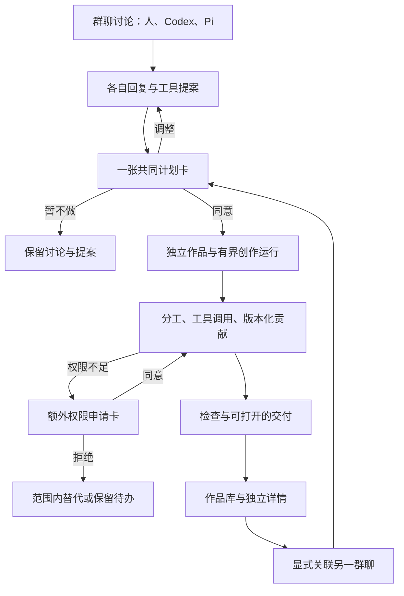

# 从群聊发起的多 Agent 作品共创

日期：2026-11-11。状态：设计提案，待用户审核；没有实现或真实共创验收结论。

代码基线：`origin/main`，`ae19ed3e13a717c021b5fa3941c69a5273255620`。对外品牌为 AgentRoom，现有 AgentStudio 包名、数据目录与协议身份继续兼容。

## 1. 目标与已知要求

用户在群聊中和人、Codex、Pi 等伙伴讨论想法。Agent 分别回复、帮助澄清目标并提出创意，通过真实工具提出可审核的创作计划。用户同意后，参与者自行分工、交换必要信息、完成修改和检查，交付可以打开的作品。

作品有自己的身份和生命周期，可以跨群聊、跨 Agent 继续迭代。群聊是发起与讨论入口，作品库是再次发现、查看和继续创作的入口。删除、离开或更名一个群聊不删除作品。

每位 Agent 都可在自己实际具备的能力内调用同一套共创工具、提出计划或申请额外权限。授权之后的计划内工作连续执行；扩大参与者、文件范围、外发目标或运行能力时再展示新的权限申请。

首个实现闭环：同一 Mac、同一所有者，真实 Codex + Pi，两位各自发言、共同形成一张计划卡，经一次同意后完成文档或静态网页，并能在第二个群聊继续修改同一个作品。

人类参与者沿用联系人模型。当前非所有者的人类联系人仅本机保存，没有真实跨设备收发、会话认证或远端审批能力；本稿不把这一限制包装成已实现的多人协作。未来接入经认证的人类会话时复用相同提案、贡献和权限接口。

## 2. 方案与取舍

| 方案 | 收益 | 代价与边界 |
| --- | --- | --- |
| 所有 Agent 直接写同一个目录，并协商文件认领 | 接入现有 CLI 快 | 文件覆盖、撤权、版本追踪难以可靠落实，依赖 Agent 自觉 |
| 统一工具内核，每个创作步骤使用独立工作副本，提交贡献后合成版本 | 工具可复用，权限和操作有回执，可跨群继续 | 需要工具适配、版本与任务协调层 |
| 同一编辑器中的实时协同编辑 | 适合人与 Agent 同时编辑文档和画布 | CRDT 只能处理数据合并，还需语义冲突、权限和执行模型 |

用户在本轮明确选择第二种方案：“统一 tools + 版本化修改”。这一方向已经确定，完整设计仍待审核。首版工作副本用受控目录与基于文件哈希的贡献，不强制每件作品初始化 Git。需要接入真实代码仓库时再支持 Git worktree；实时编辑以后可作为作品编辑器的能力加入。

## 3. 当前代码中可复用和必须新增的部分

可复用：`messenger.mjs` 的联系人、成员可见范围和按成员调度；`runtime.mjs` 的执行与恢复；`agent-scheduler.mjs` 的有界排队；`store.mjs` 的 SQLite WAL、事务与幂等；现有原生 IPC、通知、审批入口和模型快照。

必须新增：独立作品对象、版本与贡献、群聊关联、创作提案、能力授权、工具调用内核和创作运行。现有每次回复保存的 Markdown `artifact` 继续保留，不原地重定义为可变目录，也不自动把普通回复归为某个作品的版本。

当前群聊参与输出契约只允许 reply / silence，并禁止调用工具；Pi 使用 no-tools / no-extensions，Codex 请求只读 shell。不能只在提示词里声称它们已经能够共同写文件。

普通聊天维持“Agent 回复不递归唤醒其他 Agent”。获准的创作步骤通过独立的有界协调队列衔接，不能借此给普通群聊引入无限机器人对话。

## 4. 完整用户流程



### 4.1 讨论与提出作品

1. 用户建群，加入 Codex 与 Pi，说明目标。普通讨论不先要求建 Project、填任务表或选择文件夹。
2. 每个可用 Agent 按已有参与策略分别回复；明确 @all 时，两位都收到明确注意力。每条回复保留自己的联系人、执行后端和模型快照。
3. Agent 可以通过 `creation_propose` 提出作品或补充当前创作草案。工具产生结构化事件；模型正文里的 JSON、链接、按钮文字不直接变成可执行卡片。
4. 同一条用户消息默认对应一个共享创作草案。首次提议建立草案，后续参与者补充目标、验收条件、角色建议、步骤或不同设计方向。不同方向并列供用户选择，不按模糊标题自动合并。
5. 草案在本轮成员尚未结束时显示“正在整理方案”。成员结束或明确被跳过后，服务端封存可审核版本。所有者可选择提前采用当前方案；后续到达的贡献只能成为新草案，不能改写已封存卡片。

缺少必要产品选择时，Agent 可先正常提问，也可在卡片里列出待选择项。没有具体目标、执行者和可核查范围的提案不能变成可批准执行的计划。

### 4.2 群聊内的一张共同计划卡

示意内容：

> 制作一个个人阅读产品官网
>
> 交付：可预览的首页、页面文案和设计说明。
>
> Pi：信息结构、文案与使用体验检查。Codex：交互实现、页面整合与本地检查。角色来自本次提案，用户可调整。
>
> 允许：创建这一件本机作品；两位读取所选资料、修改作品工作副本、在计划内派工并生成本地预览。范围与运行上限可展开查看。
>
> 开始共创 / 调整方案 / 暂不做

卡片应先显示结果与分工，再显示权限摘要；完整技术参数收在详情中。用户无需理解工具协议才能决定。一次同意授权本版计划内的连续工作，不要求每次文件读取或保存再点一次。

“调整方案”可以改目标、选择设计方向、变更成员和分工，并生成新版本。审批绑定规范化后的计划内容哈希与版本；旧卡、双击、刷新、丢失回执不能重复创建作品或运行。

选择“暂不做”保留讨论与提案，不创建作品目录、不启动创作步骤、不产生虚假完成记录。也可由用户明确选择“只保存方案”，产生文档作品而不是执行网站计划。

### 4.3 同意之后的自主协作

1. 服务端事务保存授权与创作运行，并且先持久化排队步骤，再接受后台执行。
2. 创建稳定作品 ID，保存选定资料与 brief，按步骤依赖建立有向无环图。每个步骤绑定确定的联系人、后端、模型、权限和输入版本。
3. Agent 可以读取获准的作品上下文、领取被分配的步骤、提出范围内的子任务、发给共同参与者的工作说明。新增子任务仍受计划的参与者、文件范围、能力与预算约束。
4. 每个步骤修改自己的工作副本，通过 `artifact_submit` 提交贡献。服务端检查路径、基准版本、内容限制和前置条件后合成版本。
5. 下游步骤明确接收已提交版本和结构化交接说明。它不会靠读取其他群聊或猜测队友的聊天记录恢复上下文。
6. 调用过程生成工具活动卡与适量进展。原始参数、文件差异和回执可展开，正常读取可收起；不把内部思考或工具 JSON 当正文刷屏。
7. 调度器在授权范围内安排落实、复核与必要修正。全部必需步骤、完整候选检查及本地文件同步条件满足后，生成完成的作品结果卡；有本地未协调修改时先交付准确的待协调状态。

分工可由参与者在执行中细化；不会固定为“Pi 永远写文案、Codex 永远写代码”。首版运行默认最多一个模型子进程，最多配置为两个；逻辑协作不依赖物理同时运行，所有创作与普通聊天共用全局资源限额，手动消息优先。

派工和工作消息工具立即返回持久化排队回执，不等待另一位 Agent 完成。需要等待依赖的 Agent 调用 `task_yield`，写入不含内部思考的工作检查点；adapter 完成工具结果交接并确认本次 CLI 已结束后释放模型槽，步骤进入 waiting_dependency。依赖满足后创建新的执行 attempt，沿用原后端/模型/授权与工作副本，并注入检查点、已完成操作回执和新依赖版本，不重放旧工具作用。不能让一个仍占槽的父进程反复轮询等待子任务。

### 4.4 需要额外权限

Agent 可调用 `permission_request`，描述为什么需要新增能力。内核计算实际差额并生成单独卡片，例如新增一位设计伙伴、读取一个尚未共享的目录、向外部工具交接资料或发布网站。

已有范围内的工作可继续，依赖额外权限的步骤等待。拒绝后，Agent 可提交范围内的替代方案。请求不能自批，也不能借“完成任务”扩张已有授权；同范围未决申请去重。

授权建立前允许讨论、读取本轮明确给出的资料和写提案状态；不允许创建作品内容、改现有作品、运行项目代码或向另一个服务转发群聊材料。

### 4.5 交付、打开与继续修改

结果卡显示作品名称、当前版本、实际贡献者、已执行的检查，以及打开预览、查看文件、在 Finder 中显示、继续修改等动作。失败或只有一位完成时显示部分成果和具体待办，不能标为两位协作完成。

打开作品后，可以切换预览、文件、版本、活动与权限；保持原生窗口与现有聊天视觉语言。可展开并排聊天，并选择一个已经关联的群聊继续讨论。

后台“已完成”表示本轮交付条件满足。内容已保存、检查通过、用户接受与实际发布分别记录；没有发布授权时结果卡不会显示已上线。

### 4.6 跨群聊与跨 Agent

1. 用户在任意群聊输入或选择“关联已有作品”，从自己可访问的作品库中选择。
2. 关联卡列出作品、版本和目标群成员；默认固定共享选定 revision 的内容与必要 brief，不包含原群聊天、私人来源路径或其他未共享作品。“跟随后续版本”是另一个明确选项，卡片说明未来加入共享范围内的内容也会被该群看到，不能默认勾选。
3. 所有者确认共享范围后，建立独立 `ArtifactLink` 与权限记录。新成员没有因为加入群就获得作品权限；关联关系也不能覆盖更窄的成员权限。
4. 读者可讨论并提出修改。缺少贡献权限的 Agent 可请求它；新的修改计划仍要审核，或明确使用所有者先前为该作品授予的、尚有效的持续创作范围。
5. 新贡献继续使用原作品 ID，形成下一版本。新的修改计划可明确授权该运行产生的版本供参与者继续处理，但不扩展到其他运行产生的未来 head。原群不自动收到新群的聊天；只向当前关联且有权限的群发送有界作品事件。固定版本的共享入口不泄露未获准 head 的文件、差异或版本摘要，需要时先申请更新共享版本。
6. 移除群聊关联只取消从该群进入的权限和后续通知，不删除作品。跨群查询仍逐次检查权限，不能靠知道 ID 越权读取。

## 5. 对象与状态

| 对象 | 职责 |
| --- | --- |
| WorkspaceArtifact | 稳定身份、类型、所有者、当前整合版本、用户接受版本、归档状态 |
| ArtifactRevision | 不可变文件清单、内容哈希、父版本、贡献引用和核验范围 |
| ArtifactContribution | 某个人或 Agent 基于明确版本提交的修改与说明 |
| ArtifactLink | 作品与群聊的显式关联、pinned / follow 模式和该入口的共享范围 |
| CreationProposal | 群聊发起的可编辑草案、封存版本与规范化计划 |
| CapabilityGrant | 由所有者决定的能力范围、参与者、期限和撤销状态 |
| Collaboration | 一次获准的共创运行，关联作品、计划、步骤与终止原因 |
| CollaborationStep | 具体执行者、依赖、输入版本、可写路径、输出条件与状态 |
| ToolOperation | 宿主认定的调用身份、幂等键、参数摘要、结果及核查状态 |

作品状态主要描述 active / archived。内容准备度、执行状态、用户接受和发布状态分开。版本不可变，`headRevisionId` 是当前整合版本，`acceptedRevisionId` 只有用户明确接受时改变。

提案：draft → ready → approved / rejected / superseded / expired。

运行与步骤：queued → running → waiting_permission / waiting_dependency / verifying → completed；另有 blocked / failed / cancelling / cancelled / unknown。任意阶段都保留实际产生的贡献。审批状态不能代替执行或核验状态。

## 6. 本地目录

继续使用当前原生 profile 的 personal 数据根，不引入另一套用户数据，也不导入旧 Matrix 或其他浏览器的内容。

```text
<personal-data>/
├── personal.sqlite                 # 身份、关联、计划、权限、队列、回执
├── <existing vault files>          # 沿用既有凭据，不进入作品
├── artifacts/
│   └── aw_<stable-id>/
│       ├── manifest.json           # 可导出的作品身份/入口；服务端重建投影
│       ├── current/                # 当前整合版本的普通文件，可从 Finder 打开
│       │   ├── brief.md
│       │   ├── decisions.md
│       │   ├── index.html
│       │   └── assets/
│       ├── revisions/
│       │   └── rev_<id>/manifest.json
│       └── objects/
│           └── sha256/<hash>       # 不可变内容对象
└── workspaces/
    ├── <existing-chat-run-id>/     # 原有聊天执行目录保持
    └── collaboration_<id>/
        └── step_<id>/
            ├── tree/              # 从指定版本形成的独立工作副本
            ├── submission.json
            └── receipts/          # 不含秘密和模型内部思考
```

SQLite 是权限、队列和 head 指针的权威；版本清单与对象文件是版本内容的权威；`current/` 和根 manifest 是可重建投影。不会同时维护两份可以独立改写的正文。

用户通过 Finder 手改 `current/` 时，文件检查标为未提交修改；在导入为人的贡献或明确恢复之前，宿主不得覆盖。新不可变版本与 head 可以先安全保存，但物化状态为 blocked_by_local_changes，单独记录 currentRevisionId；预览显示新的确定版本，Finder 动作明确提示仍是原本地文件。该运行保留“版本已保存，本地文件待协调”，不标为全部交付完成。

协调动作提供把本地修改导入为人的贡献、保留副本后采用新版本，或导出新版本到另一个目录。常规物化不得递归覆盖 current；替换前保留旧树，并持久化可恢复的操作记录，处理检查之后发生的并发手改。任何未协调的旧树都不自动清理。重启不能仅因 head 更新就覆盖这些文件。

预览始终指向一个确定的不可变版本，而不是可能半写的工作副本。文件夹改名不改变作品身份；作品标题不直接用作安全路径。

首版只写宿主拥有的作品根，不接受 Agent 提供任意绝对目录。未来导入既有仓库通过原生目录选择与单独授权。导出普通文件不会默认带出群聊、访问令牌或执行历史。

## 7. 统一工具契约

工具内核是服务端唯一执行入口，同一组 JSON Schema、输入校验、权限判断、幂等与错误语义由各 adapter 复用。模型可主动选择调用，宿主确认工具结果并生成卡片。

| 工具 | 能力与关键约束 |
| --- | --- |
| `artifact_list` | 仅列当前身份获准发现的作品与版本摘要 |
| `artifact_read` | 读取指定版本的获准路径；显式大小与文件数量上限 |
| `creation_propose` | 创建或补充本轮共享草案；宿主绑定会话、消息与提议者 |
| `creation_update` | 修改未批准草案，要求当前 version；不能覆盖封存计划 |
| `permission_request` | 申请一个准确的能力差额；只产生申请，不执行被申请动作 |
| `collaboration_status` | 读取当前运行、依赖与已提交交接；不能枚举其他运行 |
| `task_claim` | 领取本人被允许执行的步骤；租约与执行代次由宿主管理 |
| `task_delegate` | 在同一授权的参与者、范围与预算内提出子步骤；拒绝环与越权 |
| `task_yield` | 保存工作检查点并退出本次模型 attempt，等待依赖时释放执行槽 |
| `collaboration_message` | 向同一授权参与者传递有界工作说明，由协调器投递 |
| `artifact_write` | 仅修改本步骤副本，要求预期文件哈希或明确创建标记 |
| `artifact_submit` | 提交完整差异与基准版本；只生成贡献，由宿主决定合成 |
| `artifact_check` | 运行已批准、宿主实现的固定检查，不接收任意 shell 命令 |
| `task_complete` | 请求结束步骤；宿主核对实际提交和必需检查后决定状态 |

删除文件属于明确的变更动作，同样提交 expectedHash；没有默许递归删除。工具目录声明哪些调用产生提案、读取、工作副本修改、版本合成或对外作用；`readOnlyHint` 不作为权限证明。

每次调用的 contactId、threadId、runId、workId、stepId、后端绑定和有效 grant 都从可信运行上下文注入，模型不能在参数中伪造身份。幂等键由运行身份与实际 toolCallId 绑定；更换参数不能重用旧键。

常见错误用稳定代码返回：permission_required、grant_revoked、stale_revision、file_conflict、invalid_path、step_not_owned、budget_exceeded、operation_unknown。错误说明包含可以采取的下一步，不把拒绝或未知状态格式化为成功工具结果。

## 8. Codex、Pi 与其他 Agent 的适配

首版保留既有普通聊天 adapter 的兼容路径；工具能力检查通过的 Codex/Pi 在每次普通群聊消息上直接启动 conversation-tools 模式，不依赖“创建作品”等关键词。这个模式只开放提案、权限申请和共同可见的只读工具，最终仍返回 reply / silence；原先的禁止工具提示与 no-tools 参数只保留在无工具兼容路径。原生工具调用与最终参与决定分别解析，工具错误不得隐藏为 silence。

批准卡片后才启动绑定具体 grant 的 collaboration-step 模式并开放对应写工具。两种模式使用不同的可信上下文与工具集合，不能通过模型一句“进入创作模式”自行切换。正文回复、工具请求与工具结果分别进入流式事件。能力检查不通过时普通聊天仍可用，但明确提示该助手当前不能产生可执行创作卡，不伪装成工具已调用。

Codex 首选每次运行显式接入一个 AgentRoom MCP 工具端点；进程级参数，不改用户全局 MCP、技能或提供商配置。Pi 使用随应用打包的可信扩展注册同一组工具，关闭自动扩展、技能、上下文文件发现及默认写入/bash 工具，仅显式加载本次工具。

需在第一实现阶段针对本机实际版本验证关闭额外工具及可见目录的方式。当前观察到 Codex 0.163.0、Pi 0.85.1，但版本存在不等于工具接入成功。若某 adapter 无法落实所声明的能力控制，创作模式明确不可用，保留普通聊天，不以提示词冒充强制隔离。

工具代理通过宿主拥有的私有本机 IPC 绑定一次运行；能力凭据不进入提示词、卡片、正文、argv 或导出。具体私有 IPC 封装可由实现者按现有 Electron/Node 能力选择，必须测试其他运行无法复用身份。

模型、提供商、思考配置沿用已接受的联系人快照。失败不能换成另一个 CLI 或模型；两位角色绑定同一个后端也不能冒充 Codex + Pi 两个执行器的验收。

Muse 和其他远端 Agent 后续通过它们实际支持的协议适配。普通聊天连接不自动拥有本机目录工具；只能交接明确共享的版本和取回贡献，不能宣称已经直接挂载目录。现有远端审批保持自身边界。

## 9. 授权、跨群可见性与执行范围

授权至少绑定：规范化计划哈希、所有者决定、作品或待创建作品身份、参与联系人和绑定版本、允许读写的相对路径、可用工具族、可向哪些参与者交接、运行期限与预算。

默认一张计划只覆盖一次本地共创运行，30 分钟、最多 24 个步骤和 200 次工具调用；可在卡片详情调整。暂停不重置预算。持续修改权限需所有者明确选择并限定作品、参与者与期限，不由一句聊天中的“以后都可以”自动推断。

作品内容访问使用独立 grant，并记录是所有者直接授予还是经某条群聊关联派生。群成员、群响应策略、历史可见范围、作品权限是不同事实。添加成员不继承旧成员授权；改变后端绑定或移除关联时使受影响授权失效，派发与每次工具调用都再次核对。退群撤销由该群派生的后续访问，不撤销无关的所有者直接授权。移除后端或身份未知不会把任务悄悄改派。

从群中移除 Agent 时，立即冻结由该群派生的当前创作 attempt、撤销其群来源能力并确认停止。已暂存而未合成的贡献保留为 quarantined，不能随后自动合成；所有者若要采用，需重新授权并重查当前输入/版本。已合成版本保留历史归属，不倒改或删除。原本“保留已接受群聊运行”的兼容行为不能绕过这一创作撤权规则。

撤权能阻止后续读取、派工与提交，不能收回已经被参与者或模型读取的内容。共享检查必须在读取某个版本时执行，不能先把全局 head 发给模型再让模型过滤。

新参与者可能获得明确共享的当前作品内容，包括该版本内已经存在的文本；卡片应说明这一点。不能借“共享当前作品”自动回传原群消息、未选择附件、来源账户或执行日志。

普通 Agent 只能提出建议、贡献和申请。首版只有当前本机所有者可以批准权限；未认证的人类联系人不能仅凭名字获得批准能力。

内核能强制控制通过自身工具执行的作用。现有 CLI 的外部插件或任意宿主进程权限不因此自动被隔离；上线创作模式前必须验证 adapter 的有效工具集，不能声称这是同一系统用户下的完整安全沙箱。

### 群聊输出与工作上下文的隔离

conversation-tools 的作品读取范围取该条回复全部接收者当前权限的交集，并与原接受消息的 recipientIds 相交。模型的输入和工具返回从一开始就不含仅它自己可见的作品文件。发布前再校验接收范围；若运行期间撤权导致已经读入的内容不再共同可见，保留受限回执，阻止该回复/卡片正文发布，不能事后依赖模型隐藏敏感段落。

collaboration-step 的工作上下文只覆盖所有者与本计划明确批准的工作参与者共同可见的资料；不同写入范围不等于获得其他资料的读取权。私有步骤的工具参数、工作消息、日志和生成回复不直接插入较宽的群聊。群内进度用宿主生成的无内容状态；最终卡只带获准版本引用。需要解释性摘要时，用全新、仅含目标群共同可见资料的汇报运行生成，不能复用已经读过更窄资料的模型上下文。

单独私有资料若确实是共创必需输入，应先通过共享申请纳入明确工作范围。输出继承所用输入的可见范围，不能仅因被写入作品就扩大接收者；所有者显式分享选定成品版本才建立新的内容共享范围。

## 10. 文件冲突、版本提交与恢复

### 提交

相对路径拒绝绝对路径、`..`、NUL、符号链接及越界解析；写入采用防链接检查和原子替换，并复核根身份，不能只做字符串前缀判断。首版限制单文本文件 1 MiB、一次作品 256 个文件/32 MiB；二进制资源需后续受控导入工具。

贡献必须包含 baseRevisionId、原文件哈希、修改内容与来源。宿主记录每步通过工具实际读取的文件/版本哈希，并把计划声明的 brief、接口、设计约束等语义输入作为 mandatory input fingerprints；模型不能通过省略依赖来跳过检查。

不同文件的修改只有在输入指纹仍有效时才可基于共同祖先合成。即使写集互不重叠，brief 或接口等输入发生变化也将贡献标为 stale，要求在预算内重基、重读变化并重新生成/复核；超预算或目标超出原批准范围时保留贡献并申请新计划。同文件采用三方比较，无法确定安全合成时保留两份贡献并排队解决，不能用“最后写入者获胜”。图片、设计二进制不自动合并。

宿主先构造完整合成候选，写并读回其内容对象与不可变清单。所有必需检查都运行在该完整候选上，回执绑定候选 manifest 哈希、预期父 head 和检查政策版本；不能把各步骤工作副本分别通过视为合成通过。head 变化时重新合成并针对新的候选哈希重做检查。

候选可由拥有该运行检查权限的预览协议读取；“字节已核验的候选”不等于全部检查通过或成为 head。这样运行时预览检查不依赖先发布 head。通过后，在同一数据库事务中用 expected head 更新版本指针、记录贡献/操作结果和物化待办。崩溃产生的未引用对象保留待核查，不把文件存在当作提交成功。重启按持久操作 ID 补齐已提交版本的物化，遇本地修改则阻塞物化，不重复执行模型或外部动作。

自动合成需要本次 grant 的 merge 能力、计划范围未变、必需检查通过；已整合不等于用户语义验收。版本恢复是创建引用旧内容的新 head，不改写原版本或贡献作者。

### 中断与撤权

停止共创先冻结新工具调用和派工，撤销运行能力，再中断本任务拥有的执行器。晚到回调不得提交新 head。工作副本和已提交贡献保留，其他群聊、作品、模型进程与应用不受影响。

排队但未开始的步骤可恢复；执行中且没有最终回执的步骤进入 unknown，先核查，不能重复调用模型或重放有作用的工具。只读/物化补齐与外部作用的恢复策略分开。原生退出、测试 profile 切换和重启检查需把提案、授权待办、共创步骤及未知操作纳入 blockingRuns。

## 11. 预览与交付类型

首版支持 Markdown 文档与无构建依赖的静态 HTML/CSS/JS 网页。它们足以完成第一轮真实共创；React/Vite/Node 服务、安装依赖、任意项目脚本和部署作为后续明确能力，不从本地预览授权推导。

网页预览通过主进程拥有的专用协议读取某个已核验版本。协议只接受不透明作品/版本 ID 与经过校验的相对路径，不暴露任意 file 路径。renderer 沿用固定 IPC，没有任意网络或 shell 接口。

生成网页进入无 preload 的隔离 iframe，使用 opaque origin；允许必要脚本但不允许同源身份、顶层导航、弹窗、表单、自动下载或外网连接。CSP 由宿主强制附加，不能由生成页面覆盖。后续需要网络时必须显式申请另一种预览能力。

固定检查包含入口存在、相对资源完整、基础 HTML 检查、预览运行错误与用户选择的窄屏检查。不要把静态检查通过宣称为完整产品可用性、真实后端或上线验收。

## 12. 模块与 API 落点

服务端新增 `artifact-store.mjs`（内容与版本）、`creation-service.mjs`（草案与权限）、`collaboration-runtime.mjs`（步骤图与恢复）、`artifact-tools.mjs`（统一 schema/调用），以及 Codex MCP/Pi 工具薄适配。业务政策不重复写在两个 adapter 中。

现有 `store.mjs` 加新的 document kinds 和事务助手；保留旧 `artifact` 及其下载接口。`runtime.mjs` 负责接入新的工具事件与运行种类，避免将新队列塞进普通群回复的递归逻辑。

新界面组件建议为 `CreationCard`、`ToolActivityCard`、`ArtifactLibrary`、`ArtifactWorkspace` 与 `ArtifactShareDialog`。复用现有 DecisionView 的视觉与可访问性，但不能复用目前“批准后只能排队原远端 run”的业务假设。

API 命名空间：

| 接口 | 用途 |
| --- | --- |
| `GET /api/library/artifacts` | 所有者作品列表，查询有界分页 |
| `GET /api/library/artifacts/:id` | 作品元信息、当前版本与权限摘要 |
| `GET /api/library/artifacts/:id/revisions/:revisionId` | 不可变清单，内容用受控读取 |
| `POST /api/creation-proposals`、`POST /api/creation-proposals/:id` | 用户/工具提出或更新草案，要求 clientId/version |
| `POST /api/creation-proposals/:id/decision` | 审核规范化计划，幂等创建 grant/运行 |
| `POST /api/library/artifacts/:id/links` | 审核后的群聊关联及共享范围 |
| `POST /api/capability-requests/:id/decision` | 批准/拒绝额外权限 |
| `GET /api/collaborations/:id` | 步骤、贡献和实际状态 |
| `POST /api/collaborations/:id/control` | stop / reconcile / retry，按具体步骤授权 |

人类修改贡献、接受版本、恢复与归档也通过固定路由，要求 clientId 和 expectedVersion。实施时将参数 schema 与既有 IPC allowlist 同步，不允许 renderer 构造任意 URL/路径。GET 内容不能绕过作品访问检查。

新增模块必须同步进入桌面复制、watch、运行指纹和原生注册检查，不能出现辅助 Web 可用但实际打包应用缺文件。`api.md`、`architecture.md`、`clients.md`、桌面 README 和 roadmap 随实际行为更新。

## 13. 用户要求的 Eval

### A. 确定性流程与边界

隔离 profile 与合成 CLI/工具先验证：两位独立回复、提案汇总、批准前零作品内容写入、拒绝不执行、过期卡与双击不重放、没有额外授权时不能外发/读其他作品、同文件冲突不覆盖、语义输入变化使贡献失效、完整候选检查绑定、移除成员与晚到回调、群回复不泄露非共同可见资料、串行派工能释放槽、崩溃后的 head/操作一致性、本地手改不被物化覆盖、预览不能访问原生 bridge 或外网。

加入第二个群聊并共享同一作品，证明 ID 不变、版本递增，第二群和新 Agent 的上下文没有原群私密标记。移除关联或后端变化立即使受影响工具调用失败。普通聊天的 silent/mention/always/manual、原审批与现有所有者数据仍分别回归。

### B. 真实 Codex + Pi

在隔离测试 profile 中使用本机已配置的两个执行器，保留各自模型快照；只发送合成产品需求，不读取私人聊天或创建外部资源。

1. 建群，加入真实 Codex 与 Pi。用户发送一段尚不完整的官网想法，明确请两位各自提出设计建议并形成共同计划。
2. 观察两个实际运行分别回复；内容要各自有可辨认的建议，不能由宿主替另一个 Agent 生成固定文本。
3. 至少一个真实工具调用提出计划，另一位实际参与补充。形成一张包含两位分工的可审核卡，批准前检查作品内容目录没有变化。
4. 通过实际界面点同意。两个真实执行器分别调用同一套工具，产生可归属各自 runId 的实际文件贡献；两位都存在不等于两位都贡献。
5. 对最终版本运行固定检查，打开实际预览，记录截图、文件哈希、工具回执与运行版本。最终交付包含可打开网页、brief 和设计选择说明。
6. 新建另一个群，显式关联该作品，提出一个小修改。至少一个获准 Agent 创建下一版本；旧版仍可打开，作品 ID 不变。
7. 关闭、重开应用后从作品库打开同一作品；未完成步骤和权限请求如实恢复。

`delivery_completed`：两位真实执行成功、实际贡献可归属、必需文件与检查满足且预览可打开；`user_accepted`：用户明确接受；`published`：另有发布权限与实际回执。三项单独记录。

真实 CLI 失败、额度限制、工具能力不兼容时保存失败与部分成果，不改用假 CLI、其他模型或另一后端补位。辅助 Web 的合成通过不能替代真实 Electron 的工具卡、批准、预览与重开验收。

### C. 测试入口与证据

拟新增 `artifact-tools.test.mjs`、`collaboration-runtime.test.mjs`、`artifact-store.test.mjs`，覆盖实际政策和故障，不只镜像实现；端到端入口 `dev/artifact-coauthoring-acceptance.mjs`，真实入口显式 `--real`。

界面合同至少包含 `im-creation-proposal`、`im-creation-approve`、`im-tool-activity`、`im-artifact-result`、`artifact-library`、`artifact-workspace`、`artifact-preview`、`artifact-share` 和具体步骤控制 test-id。先写入 clients 合同，再用它们定位；等待状态与事件，不用固定 sleep。

测试前运行 storage audit，使用注册产物目录；模型默认串行，复用已有构建。保存正式证据后只清理本任务独占、可重建且没有活动引用的产物。真实账号、模型、原生包与合成检查分别报告。

## 14. 实施顺序与本稿未替用户决定的内容

1. 确认两种 CLI 的受控工具可行性；完成共享工具 schema、身份注入、能力门禁与失败测试。
2. 实现作品内容/版本、权限、贡献合成与恢复；加入 API/IPC 和 profile 生命周期。
3. 实现群聊提案、共同卡片、授权和步骤协调，保持普通聊天边界。
4. 实现作品库、独立详情、隔离静态预览与跨群共享。
5. 确定性端到端、真实 Codex + Pi、实际 Electron 验收；独立代码审查；修复高优先级问题后按仓库门禁交付。

具体 IPC 封装、对象索引与组件拆分由实施者结合实际版本决定。首版静态网页、默认预算、串行运行、两类产物和不含跨设备人类投递是本稿的建议范围，需要用户审核；不是推定已经接受的产品决定。

本稿只新增设计与研究记录，不改变运行合同、全局工具配置或用户现有数据。批准后再写实施计划和产品代码。

## 15. 独立设计审查

独立 builder check 提出的重要问题已补入本稿：读取集与语义输入失效、共享固定版本与跟随模式、群聊共同可见输入、移除成员后隔离未合成贡献、串行等待释放执行槽、自然聊天的工具模式入口、完整合成候选检查，以及本地手改时的物化状态。

默认固定版本共享、工作上下文与群聊汇报分离、`task_yield` 检查点，以及 head 可保存但本地文件未协调时不宣称交付完成，都是作者在审查后作出的具体实现建议；用户仍可在设计审核中调整。
