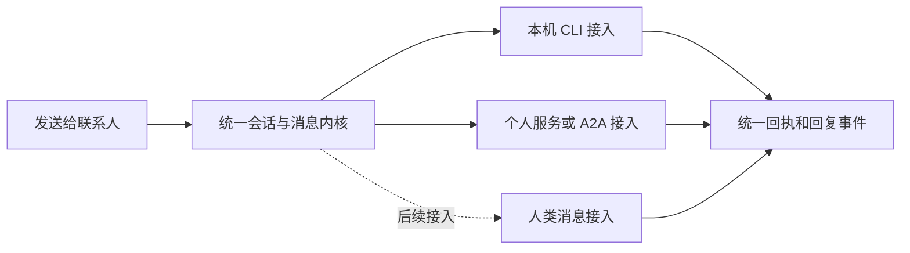

# 统一联系人与本机 Agent 推荐 · 设计草案

2026-11-11。状态：供讨论的产品与架构方案，尚未实现。

## 已确认的方向

用户希望 Muse、Codex 和人类共用联系人、消息、会话与回复体验；普通聊天不逐条审批。人类接入最终需要好友同意，Agent 可以依据宿主状态提出配置建议，由用户采纳。用户已明确第一版只用自己的 Mac，发现本机已安装或已经连接的 Agent。

本稿建议采用一个消息内核、多个接入适配，先交付本机发现与角色推荐。姓名和头像可以相似，身份、接入授权和真实投递能力仍必须明确。这里的具体产品规则是设计建议，不代表用户已逐条确认。

## 现有能力与衔接

- `main` 的 `Contact` 已支持人或 Agent、独立角色指令、模型偏好、头像，以及本机 CLI/远端 connection 绑定；聊天与历史任务共用 Messenger。
- 免逐条聊天审批修复在独立提交 `bc66f57`：A2A 联系人聊天直接发送，工具调用与原有任务转发保留精确审批。该提交的存在不代表已合并、已安装或真实 Muse 账号已验收。
- GET-490 分支已有角色准备流程：实际选定后端探测、基于有限工作区资料提出角色、用户明确采用后创建联系人。该分支也在扩展群内参与策略。本设计沿用这个入口和执行队列，不再创建第二套推荐任务或群响应规则。
- 人类联系人目前只有本机记录，没有跨设备投递。第一版继续如实说明，不能把保存或模拟回复当作好友接收。

## 方案取舍

| 方案 | 收益 | 代价与结论 |
| --- | --- | --- |
| 每种提供商各自实现聊天与授权 | 改动局部 | 收发状态、重试、审批与回复展示容易再次分叉，不采用 |
| 统一消息内核，接入差异封装到 adapter | 已有多种真实接入可以复用同一条会话链路 | 需要规范能力和回执含义；推荐本方案 |
| 一次建立多设备、多人和 Agent 网络 | 从一开始拥有完整好友系统 | 超出用户确认的第一版，身份同步和远端授权成本过早引入，后续再做 |

## 一套联系人，分开三件事

**联系人身份**回答“我在和谁说话”。保存稳定 ID、名称、头像、`kind: human|agent`、说明；Agent 另有角色指令和配置策略。不同角色可以共享同一个 Codex 后端，但保留各自的联系人 ID 和私聊。

**关系与授权**回答“我是否已接纳这个联系人，它能接收什么”。本机已发现不等于自动成为新联系人；用户采用角色才建立关系。自己的已登录服务可以通过明确连接建立关系，无须虚构对方也接受了好友申请。人类和他人的 Agent 未来走真实申请与同意流程。

**执行与连接**回答“这条消息实际由什么处理”。本机 Codex、Pi、Claude 和已连接的 Muse 等作为接入适配。一个角色第一版只绑定一个明确后端；不因忙碌、登录失败或报价变化，偷偷切到另一提供商或账号。

角色独立不等于服务会话独立。本机临时 CLI 执行可以显式输入各自上下文；某些原生网页接入却只有一个实际服务会话。第一版为已连接 Muse 等服务推荐“使用已有联系人”，不为同一个单会话服务自动复制出多个独立伙伴。需要多身份或跨私聊/群聊使用时，先明确该 adapter 是否具备实际的逐会话隔离；单会话或未知接入必须复用其既有会话，不能把本机 payload 过滤宣称为提供商侧历史隔离。已有历史记录保留，但不据此扩大独立会话能力。

MCP 工具连接本身不是会聊天的人格。它可以为 Agent 提供工具能力；用户显式建立工具助手时，必须同时确定承担对话和规划的实际后端，不能把一个工具列表当作一个已经可聊天的 Agent。



## 第一版用户流程

1. 打开联系人，看见“已添加的联系人”。“这台 Mac 上发现的助手”放在次级区域；不把所有发现结果自动塞进聊天列表，也不启动模型。
2. 可以直接给某个后端创建一个身份，或点“帮我准备合适的伙伴”。已连接 Muse 不需要重新登录，只核对它仍绑定同一个个人服务。
3. 默认只参考当前角色、群名称与成员概况。近期群聊文字和已保存记忆可选；沿用 GET-490 的范围控制，不读取私聊、其他项目、终端历史或凭据。若建议调整现有默认开关，作为明确的 UX 变更处理，不能悄悄改变已接受的准备任务。
4. 点击开始时说明会用哪个已配置助手准备建议；此时才进行必要的真实可用性探测和分析。纯资源扫描不调用模型。成功探测只说明那次配置执行成功，不保证未来额度和持续在线。
5. 首屏只呈现 1–3 个最相关建议，可再展开全部结果。建议新角色时主动作是“添加”，次要动作“调整”；建议已经存在的 Muse 或其他联系人时主动作是“打开聊天”，不重复创建。新角色沿用 GET-490，绑定本次实际测试的本机后端配置。修改过的身份草稿持续保留，关闭或刷新不丢。
6. 添加后直接进入私聊，输入框可用但不自动发送欢迎词。推荐中涉及已有群聊时，只提出“适合加入某群”；添加联系人不顺带入群或获取旧历史。

下方是说明结构的示例，不代表真实探测结果：

```text
研究伙伴                       Agent
由这台 Mac 的 Codex 提供

适合帮你核对来源、整理讨论中的问题。
建议依据：你选中的群概况和已明确填写的工作目标。
模型：使用刚测试通过的配置

[添加]  调整
```

“调整”逐层展开角色说明、模型与思考深度、可用工具、响应策略。地址、协议、凭据和执行回执留在连接详情，不占用日常聊天表面。

## 宿主状态如何影响建议

宿主是这台 Mac 的运行事实，不是另一个聊天身份。探测结果包含来源、采样时间、支持状态和配置版本；未知状态不能显示成健康。

| 输入 | 用途 | 不作出的推断 |
| --- | --- | --- |
| 已安装后端、已有连接、支持的执行能力 | 过滤可用候选，区分待登录与暂不支持 | 检测到安装不等于账号和模型已验证 |
| 实际支持的模型、提供商、思考档位 | 只提出当前账号配置可执行的组合 | 不自动推荐未配置提供商或宣称知道价格、额度 |
| 内存压力、磁盘余量、现有任务队列 | 提醒排队、减少额外准备工作 | 云端模型能力不由这台 Mac 的内存大小决定 |
| 用户填写的目标、选择的角色与群概况 | 提出角色分工及适合的已选群聊 | 不把宿主指标当成用户偏好或能力评分 |

资源判断先用可解释的规则筛选；语言模型负责把角色和理由写清楚，不负责决定是否越过账号、权限或资源限制。系统指标无法可靠读取时展示未知，不能用剩余内存简单伪造 macOS 内存压力等级。

第一版继续复用现有单工作者队列，不新增并行 Agent 池。宿主忙时排队；忙碌不会反复要求用户批准，也不创建同名“更轻量伙伴”。以后若支持本机模型，才基于其真实需求增加硬件适配判断。

推荐采用经过测试的明确配置，与 GET-490 的采用语义一致。用户可主动选择跟随本机默认；此时界面说明之后新消息会跟随已保存默认值。已接受的运行和重试保留原配置快照。资源变化只影响之后的排队或新建议，不改写现有角色、配置与接受中的消息。

推荐有来源和版本，同一份建议重复点击返回同一联系人。重载可恢复准备进度；中断和失败明确保留，不自动调用其他模型重做。忽略某个建议后不因每次状态采样再次弹出，用户可主动重新准备。

## 普通聊天与需要决定的动作

| 用户在做什么 | 行为 |
| --- | --- |
| 给已添加的聊天联系人发送普通消息 | 直接发送；不再显示一张重复的“允许发送”卡 |
| 查看已安装助手与宿主状态 | 本机只读发现，无模型调用、无权限扩大 |
| 点开始准备角色建议 | 使用界面选定的助手和资料范围；可以取消 |
| 采用新角色或修改该角色配置 | 展示要保存的差异，保存一次即生效；不全局改 CLI 默认 |
| 调用 MCP 工具、发起账号操作、历史任务转发 | 第一版保留原有具体动作、目标、参数和版本确认；不扩大现有工具授权 |
| 服务自身需要操作确认 | 保留并指向该真实决定，不自动代替用户作答 |
| 首次接入一个账号或未来添加人类好友 | 在建立连接或关系时完成同意，不能由 Agent 自述替代 |

普通聊天的授权只覆盖当前联系人及其会话资料。它不会默许转发给另一个 Agent、分享私聊或执行未列明的工具操作。对已有连接的身份、账号或地址发生变化，明确处理连接变更；不把每次普通收发重新包装成审批。

## 消息状态也统一，能力不伪造

所有接入向会话内核提交消息事件与回执。内核处理去重、因果顺序、回复归属、附件、草稿、停止和恢复；adapter 处理该提供商的登录与具体协议。

- 消息正文以稳定发送者 ID、会话 ID、逻辑消息 ID 和可选回复对象为核心。`user/assistant` 是提供给模型时的角色投影，不能作为区分真人、Agent 或账号归属的唯一依据。
- 发送状态与 Agent 生成状态分开。消息可以“已保存/排队/发送中/有回执/失败/待核查”；Agent 回复另外显示准备、生成或停止。
- “有回执”必须说明来自哪一层。收到本机服务的任务 ID，不等于真人已读；接入没有提供可靠已读能力时不显示已读。
- 一条回复的流式增量、最终正文和失败残文属于同一个逻辑回复，不能不断新增气泡。接入只提供最终结果时，不伪造流式文字。
- 结果不确定先核查原消息或 task ID，不能用点击重试生成第二次外部发送。账号或连接变化不改变已接受消息的目的地。
- 群内谁能回应沿用明确的成员与响应策略；推荐采用不重置现有群策略，Agent 的输出不自动形成无限互相唤醒。

第一版不扩大离线发送语义：不可用的直接联系人仍保留当前可编辑草稿并说明原因，沿用现有未接受请求的处理；不要为了“统一”暗中改成会在未来某刻自动发出的新 outbox。独立的离线投递能力可后续设计。

## 身份与状态的最小内部契约

- `Contact`：稳定身份、显示资料、Agent 角色与配置策略；既有 ID、私聊和用户改名不变。
- `ContactRelationship`：发现、已添加、移除等关系事实；与在线/登录状态分开。自己的服务不生成虚构双向好友回执。
- `ExecutionBinding`：实际后端、连接/凭据版本与配置版本；秘密只留在后端。第一版一个角色一个绑定，不透明迁移。
- `HostSnapshot`：本机稳定标识、采样时间、能力、可读到的资源状态；不含原始进程命令、路径、聊天和密钥。
- `AgentProposal`：目标、来源范围、来源 ID、新角色或既有联系人的建议、已测绑定配置、创建时间、是否采用及采用的联系人 ID。既有联系人建议必须引用允许范围内的真实 ID，不能让模型编造新连接地址或账号。
- `Message` 与 `Run` 继续复用：人类会话也有消息，但不强行生成模型运行。MCP 作为工具能力接入，不伪装为独立对话后端。

界面只调用少量稳定动作：发现候选、准备建议、采用建议、发送消息、处理真实决定。后端选择、版本核对、恢复和第三方协议复杂性留在它们的实现里，不要求聊天调用者逐一理解 CLI/A2A/Muse 的差异。

接入能力至少声明是否支持真实聊天、增量回复、停止，以及 `conversationIsolation: per_thread|single_service_conversation|unknown`。这些是本地 adapter 经验证的事实，不由远端自报描述或模型决定。支持的事件转换为统一的接受回执、回复增量、最终回复、需要输入、失败和结果未知；缺失能力明确保留，不能通过统一界面伪造出来。

这些是逻辑职责，不要求第一版分别建六张表或增加六层包装。SQLite 继续渐进扩展。现有联系人全部保留，不因新增“候选”概念隐藏已有联系人或丢失私聊；新的发现候选才等待采用。现有本机默认读取、角色编辑、执行快照与 GET-490 准备记录优先复用。

旧 MCP 联系人采用一次明确配置的迁移：保留 ID、名字、全部消息与原工具连接，历史仍可打开；尚未绑定对话后端的联系人，对新消息显示“选择对话助手”，选择实际可用后端并保存后再接受新消息。不能默默把全局默认或某个新提供商写成它的对话身份。这是首次补齐配置，不是每条消息审批。迁移不重新提交或改写已接受、排队、执行中、待决定和待核查的旧运行，它们继续沿用已有记录与原有恢复语义；工具调用仍需原有精确决定。此项只影响之前隐式依赖规划器的 MCP 工具助手，不影响已可聊天的本机或 Muse 联系人。

## 分批实现与验收

1. 合并好普通聊天免重复审批与 GET-490 的角色建议契约：有针对性地解决两者都修改 runtime、messenger 和文档的地方，不能整文件覆盖；保留本机群自动参与与远端聊天直接发送的各自语义。
2. 为现有发现增加宿主事实和候选投影，在同一个角色准备入口给出可解释的建议。先不改全局并发和默认群策略。
3. 把建议采用、单角色配置修改、版本失效与不重复提示补完整；迁移只保留既有身份，不主动发消息。
4. 独立验证断网、待登录、资源状态未知、模型不可用、重复采纳、准备期间修改配置、重启、群历史隔离和已有聊天连续性。真实服务账号与合成测试分别记录。

验收标准：不出现逐条普通聊天审批；推荐来自真实可用候选且依据可见；未采用不创建联系人、不入群、不改配置；采用后能直接聊天；账号、可见范围和已接受配置不被推荐或宿主变化覆盖。

后续再设计其他设备配对、人类好友申请、远端 Agent 所有者授权，以及真正的跨设备同步。第一版不新增中心账号、公开目录或 Agent 市场，也不把宿主自报状态当作他人身份的证明。
